# FictionBook Editor Next

**FictionBook Editor Next (FBE Next)** — бесплатный редактор электронных книг формата **FictionBook 2 (`.fb2`)** для Windows. Проект продолжает развитие классического FictionBook Editor: сохраняет привычное визуальное редактирование, работу со структурой книги и JavaScript-скриптами, дополняя их современными инструментами и повышенной надёжностью.

**Актуальный стабильный выпуск: [3.0.10](https://github.com/sklart/fictionbook-editor-next/releases/tag/v3.0.10) (23 октября 2026 года).**

[**Скачать**](https://github.com/sklart/fictionbook-editor-next/releases/latest) · [Что нового в 3.0.10](https://github.com/sklart/fictionbook-editor-next/releases/tag/v3.0.10) · [Все выпуски](https://github.com/sklart/fictionbook-editor-next/releases) · [Сообщить об ошибке](https://github.com/sklart/fictionbook-editor-next/issues) · [Документация](docs/README.md)


*Светлая и тёмная темы интерфейса FBE Next 3.0.9.*

> **Кратко:** редактирование FB2 и FBD, визуальный редактор и XML, таблицы, сноски, иллюстрации, скрипты, проверка качества книги, импорт EPUB и экспорт HTML/DOCX/EPUB, работа с FB2 внутри ZIP, проверка орфографии и интеграция с Проводником Windows.

## Содержание

- [Скачать и установить](#скачать-и-установить)
- [Что нового в версии 3.0.10](#что-нового-в-версии-3010)
- [Основные возможности](#основные-возможности)
  - [Редактирование книги](#редактирование-книги)
  - [Поиск и замена](#поиск-и-замена)
  - [Редактор XML](#редактор-xml)
  - [Скрипты и панели инструментов](#скрипты-и-панели-инструментов)
  - [Проверка качества FB2](#проверка-качества-fb2)
  - [Импорт, экспорт и архивы](#импорт-экспорт-и-архивы)
  - [Оформление и локализация](#оформление-и-локализация)
  - [Сохранность и диагностика](#сохранность-и-диагностика)
  - [Интеграция с Windows](#интеграция-с-windows)
- [Скриншоты предыдущих выпусков](#скриншоты-предыдущих-выпусков)
- [Совместимость с Windows](#совместимость-с-windows)
- [История развития](#история-развития)
- [Сборка из исходников](#сборка-из-исходников)
- [Обратная связь и участие](#обратная-связь-и-участие)
- [Лицензия и благодарности](#лицензия-и-благодарности)

## Скачать и установить

Для большинства пользователей подойдёт [обычный установщик 3.0.10](https://github.com/sklart/fictionbook-editor-next/releases/download/v3.0.10/FictionBookEditorNext-3.0.10-win32-setup.exe). Если необходим независимый от установки экземпляр, используйте [portable-архив](https://github.com/sklart/fictionbook-editor-next/releases/download/v3.0.10/FictionBookEditorNext-3.0.10-win32-portable.zip).

| Файл выпуска 3.0.10 | Назначение |
| --- | --- |
| [**`win32-setup.exe`**](https://github.com/sklart/fictionbook-editor-next/releases/download/v3.0.10/FictionBookEditorNext-3.0.10-win32-setup.exe) | Установщик с выбором компонентов и способа установки. |
| [**`win32-portable.zip`**](https://github.com/sklart/fictionbook-editor-next/releases/download/v3.0.10/FictionBookEditorNext-3.0.10-win32-portable.zip) | Переносимая копия: распакуйте целиком и запустите `FBE.exe`. |
| [`win32-symbols.zip`](https://github.com/sklart/fictionbook-editor-next/releases/download/v3.0.10/FictionBookEditorNext-3.0.10-win32-symbols.zip) | Отладочные символы для анализа аварийных завершений; обычному пользователю не нужны. |
| [`SHA256SUMS.txt`](https://github.com/sklart/fictionbook-editor-next/releases/download/v3.0.10/SHA256SUMS.txt) | Контрольные суммы для проверки скачанных файлов. |

**Установщик** позволяет выбрать обычную установку для текущего пользователя (*Current User*, без обязательного повышения прав), установку для всех пользователей (*All Users*, с правами администратора) или создание переносимой копии (*Portable*). Компоненты интеграции с Windows выбираются отдельно.

**Portable** хранит изменяемые настройки и данные в собственном каталоге `Data`, в том числе конфигурацию, скрипты, словари, темы, историю файлов и диагностику. Папку следует переносить вместе с `Data`. Простая распаковка ZIP не назначает FBE Next приложением по умолчанию и не устанавливает расширения Проводника.

Проверка обновлений доступна в окне **«О программе»**. Можно использовать стабильный канал или канал предварительных версий Beta/RC; portable-копия не должна превращаться в установленную версию при обновлении.

**Важно:** все основные опубликованные файлы 3.0.10 имеют архитектуру **Win32 (x86)**. Это обозначение разрядности приложения, а не требование 32-разрядной Windows: приложение рассчитано и на 64-разрядные системы. Подробнее о Windows 7 — [ниже](#совместимость-с-windows).

## Что нового в версии 3.0.10

- Исправлены тёмная тема, значки стартовой панели, подсказки, настройки EPUB/DOCX и обновление меню; системные файловые диалоги изолированы от оформления FBE.
- Добавлена команда **«Файл → Закрыть»**, улучшены создание и замена книги, восстановление дерева документа и проверка FBD после закрытия книги.
- Исправлены группы Undo и обработка ошибок при обычной и массовой замене слов.
- Повышена надёжность записи копий книги и шаблонов поиска при временных блокировках и одновременных изменениях.
- Scripting API расширен до **1.5.0 (104 метода)**: безопасное сохранение, независимые копии книги и сериализация с сохранением существующего COM ABI.
- Улучшена обработка примечаний, изображений и вложенных секций при импорте EPUB, настройки панелей скриптов и работа Ctrl+F в окне настроек.
- Исправлены обработка повреждённых числовых метаданных архивов и восстановления, освобождение ресурсов дерева документа.

[Подробное описание релиза 3.0.10](https://github.com/sklart/fictionbook-editor-next/releases/tag/v3.0.10) · [Сравнение с 3.0.9](https://github.com/sklart/fictionbook-editor-next/compare/v3.0.9...v3.0.10).

## Основные возможности

### Редактирование книги

FBE Next предназначен для ручной подготовки, исправления и структурирования FictionBook-книг:

- **«Тело»** — привычное визуальное редактирование текста без необходимости вручную писать XML.
- **«Описание»** — метаданные книги: название, авторы, язык, жанры, серия, аннотация и другие сведения.
- **«Код»** — прямое редактирование исходного XML для точной разметки и нестандартных случаев.
- Работа с главами и вложенными разделами, заголовками, эпиграфами, цитатами, стихами, примечаниями, комментариями, ссылками и иллюстрациями.
- Визуальное создание и редактирование **таблиц FB2**, включая объединённые ячейки (`rowspan`, `colspan`) и преобразование заголовочных/обычных ячеек.
- Вставка изображений разных форматов с преобразованием для FB2 (включая WebP, JPEG 2000, AVIF, HEIC/HEIF, BMP, GIF, TIFF, JPEG и PNG).
- Сохранение позиции и выделения при переходе между «Телом» и «Кодом» в поддерживаемых сценариях.
- **Ctrl+Click** по внутренним ссылкам для перехода внутри книги; наведение на ссылку-примечание показывает быстрый предпросмотр.
- Работа с файлами `.fbd` (документами описания FictionBook).

### Поиск и замена

Поиск переработан для работы с большими книгами, повторяющимися фрагментами и регулярными выражениями:

- поиск по документу, выделению и доступным областям книги;
- команда **«Найти всё»** с панелью результатов, контекстом и переходом к совпадению;
- подсветка всех найденных фрагментов без изменения FB2;
- список потенциальных совпадений массовой замены с подтверждением выполнения; сравнение текста «до/после» и исключение отдельных совпадений не предусмотрены;
- библиотека встроенных шаблонов и сохранение собственных;
- встроенная справка по регулярным выражениям.

В визуальном редакторе используется **PCRE2**, в режиме «Код» — механизм поиска **Scintilla**. Возможности и синтаксис этих режимов могут различаться; справка учитывает это.


*Поиск по книге и подсветка совпадений.*

 

*Выбор шаблона и вставка выражения в поиск или замену.*


*Справка по регулярным выражениям для соответствующего режима редактора.*

### Редактор XML

Режим «Код» основан на Scintilla и предназначен для точной работы с разметкой FictionBook:

- подсветка XML с готовыми и внешними цветовыми схемами;
- автодополнение допустимых элементов, атрибутов, закрывающих тегов и ссылок на существующие идентификаторы;
- обнаружение XML-ошибок возле проблемной строки;
- поиск парных тегов и навигация по ним;
- настраиваемое отображение невидимых символов (`NBSP`, `SHY` и другие);
- настройки текстового курсора (толщина, цвет и мигание);
- оптимизации повторного открытия представления «Код» и работы с большими документами.


*Настройки режима «Код», включая оформление, подсветку и предпросмотр.*

### Скрипты и панели инструментов

FBE Next сохраняет поддержку штатных и пользовательских JavaScript-скриптов классического редактора. Доступны большой комплект скриптов для обработки текста и структуры книги, команды их запуска и настройки собственных сочетаний клавиш.

В версиях 3.0.8–3.0.9 добавлены и доработаны:

- **отдельный режим дерева скриптов** с поиском и избранным;
- создание, переименование, скрытие и перестановка пользовательских панелей инструментов;
- индивидуальная настройка состава кнопок и разделителей каждой панели;
- привязка панелей к скриптам, сохраняемая при их переименовании или переносе внутри каталога;
- обновление списка скриптов без перезапуска приложения;
- **карточки скриптов** с назначением, авторами, параметрами, зависимостями и ограничениями;
- расширенные сообщения об ошибках загрузки и выполнения скриптов;
- дополнительные методы `window.external` для безопасной проверки и применения изменений исходного XML с поддержкой штатного Undo/Redo.

В 3.0.10 API скриптов расширен до **1.5.0 (104 метода)**: добавлены безопасное сохранение, независимые копии книги и сериализация. Описание методов и примеры — в [документации API](docs/scripting-api.md).


*Управление пользовательскими панелями скриптов.*

 

*Дерево скриптов и его контекстное меню.*


*Информационная карточка со сведениями о назначении и ограничениях скрипта.*

> **Совместимость:** существующий API пользовательских скриптов развивается с сохранением прежних методов. Однако старые скрипты могут иметь собственные ограничения Undo/Redo, а совместимость сторонних **бинарных** плагинов следует проверять отдельно. Документация для авторов — [API скриптов](docs/scripting-api.md).

### Проверка качества FB2

Кроме штатного **FictionBook Validator (FBV)**, проверяющего структуру и схему документа, FBE Next предлагает отдельный **анализ качества книги**. Он помогает находить не только формальные XML-ошибки, но и практические проблемы подготовки электронного издания.

Проверяются, в частности, внутренние ссылки, примечания, изображения и бинарные вложения, структура разделов и подозрительные метаданные. Результаты разделяются на ошибки, предупреждения и сведения; доступны рекомендации, переход к соответствующему месту XML (когда его можно определить) и сохранение отчёта в TXT или HTML. Проверку можно отменить.


*Отдельное окно проверки качества FB2.*

Проверка качества анализирует документ и не исправляет его автоматически. Она **дополняет, а не заменяет** проверку корректности FB2 валидатором.

### Импорт, экспорт и архивы

| Операция | Возможности |
| --- | --- |
| **Открытие и сохранение** | FB2, документы описания FBD; работа с выбранным FB2 внутри ZIP-архива. |
| **Импорт** | EPUB → FB2, включая распространённые EPUB 2 и EPUB 3; настройки импорта и диагностика ошибок. |
| **Экспорт** | FB2 → HTML, DOCX, EPUB 2 / EPUB 3. |
| **Пакетное преобразование** | Отдельные batch-утилиты для импорта EPUB и экспорта DOCX/EPUB. |

**Экспорт HTML** предлагает выбор оформления страницы, шрифта, ширины текста, полей, оглавления, примечаний, метаданных, обложки и режима размещения изображений. Поддерживаются автономный HTML с включёнными ресурсами и другие предусмотренные экспортёром HTML-режимы.

Можно разделить HTML-книгу на страницы по разделам, если выбран **встроенный XSL-шаблон** и совместимый HTML-формат. Для MHT, однофайлового автономного HTML и пользовательского шаблона эта возможность не заявляется.


*Расширенные настройки экспорта HTML.*

**Книги в ZIP:** если в архиве несколько FB2, редактор предлагает выбрать нужную книгу. Изменения сохраняются обратно в ZIP с защитой от частичной перезаписи. Поддержка архивного редактирования в этом режиме относится к **ZIP**, а не ко всем форматам архивов.


*Выбор FB2 из ZIP-архива.*

При ошибке или отмене экспорта HTML, DOCX или EPUB существующий результат защищён от обычной частичной перезаписи. Импорт EPUB проверяет готовность обязательных ресурсов и сообщает о проблемах обязательных глав вместо молчаливого импорта неполной книги.

### Оформление и локализация

FBE Next предлагает **светлую и тёмную темы приложения**, оформление редактора, фоновые изображения под бумагу, собственные цвета текста и фона и предварительный просмотр выбранных параметров. Для XML доступны наборы цветовых схем, включая внешние палитры.


*Оформление режима «Тело»: цвета, фон и предпросмотр.*

Интерфейс переведён на **12 языков**: русский, украинский, английский, немецкий, французский, испанский, итальянский, нидерландский, польский, португальский, чешский и болгарский. Язык можно переключать во время работы программы; для некоторых второстепенных строк используются резервные переводы. Словари орфографии выбираются отдельно от языка интерфейса.

В комплект входят словари для проверки орфографии через Hunspell. Улучшена работа с мягкими переносами, сложными словоформами и предложениями исправлений; для русского языка предусмотрен ограниченный необязательный контроль отдельных ошибок с буквой «ё».

### Сохранность и диагностика

Редактор использует безопасную схему записи документов с подготовкой временного файла и заменой результата. Для существующих книг можно включать или отключать создание предыдущей версии как `.bak` (по умолчанию включено); это не отменяет безопасный способ записи.

В последних выпусках дополнительно улучшены:

- проверки таблиц и бинарных объектов перед сохранением;
- корректное сохранение неразрывных пробелов независимо от их визуального обозначения;
- восстановление после аварийного завершения;
- Undo/Redo для вставки текста, структурных операций, перетаскивания и импорта иллюстраций;
- сохранение истории отмены при поддерживаемых XML-операциях скриптов;
- поведение «Сохранить как», списка последних документов и сохранения в архив.

Окно **«Справка → Диагностика FBE Next…»** показывает сеансы, сведения об ошибках и доступные отчёты. Можно просмотреть будущий состав ZIP-пакета, исключить необязательные компоненты, сохранить проверенный снимок и очистить старые журналы. Подготовка выполняется без блокирования основного окна; пакет **не отправляется по сети автоматически**.


*Диагностические сеансы и подготовка пакета для сообщения об ошибке.*

Подробная инструкция: [Как сообщить об ошибке](docs/reporting-issues.md). При работе с конфиденциальными книгами проверяйте состав отчёта перед передачей разработчикам; исходный текст книги не должен автоматически включаться в стандартный пакет.

### Интеграция с Windows

Установщик позволяет **независимо** включить три функции:

1. назначить FBE Next приложением для открытия `.fb2`;
2. добавить в контекстное меню Проводника команду **«Проверить FB2 на ошибки»**;
3. добавить свойства FB2 (автор, название, язык, серия и др.) и миниатюры обложек в Проводнике.

Это позволяет пользоваться другой читалкой как программой по умолчанию, но при этом сохранить дополнительные возможности FBE Next в Проводнике. Миниатюры сохраняют пропорции обложек и учитывают прозрачность PNG; повреждённая обложка не должна приводить к падению Проводника.

Подробные изображения интеграции, проверок и импорта/экспорта представлены в [исторической галерее ниже](#скриншоты-предыдущих-выпусков).

## Скриншоты предыдущих выпусков

Ниже сохранены **все дополнительные иллюстрации**, опубликованные в описаниях предыдущих выпусков, и изображения из прежнего README/каталога `docs/screenshots`. Они сгруппированы в раскрывающиеся блоки, чтобы не перегружать главную страницу. **Внешний вид некоторых старых окон может отличаться от 3.0.10**; сравнительные изображения показывают историю изменений, а не текущее состояние.

<details>
<summary><strong>3.0.8 RC2 — настройки, примечания, строка состояния, диалоги</strong> — 5 изображений</summary>

[Описание выпуска](https://github.com/sklart/fictionbook-editor-next/releases/tag/v3.0.8-rc2).


*Переработанное окно настроек*.


*Предпросмотр примечания при наведении*.


*Расширенная строка состояния*.


*Современный диалог сохранения*.


*Подсказки Hunspell*.

</details>

<details>
<summary><strong>3.0.8 RC1 — установка, обновления, таблицы</strong> — 5 изображений</summary>

[Описание выпуска](https://github.com/sklart/fictionbook-editor-next/releases/tag/v3.0.8-rc.1).


*Установщик с выбором типа установки*.


*Установка для текущего или всех пользователей*.


*Выбор канала обновлений*.


*Команды таблиц на панели инструментов*.


*Значки команд редактирования таблиц*.

</details>

<details>
<summary><strong>3.0.7 — XML-редактор, невидимые символы, таблицы</strong> — 7 изображений</summary>

[Описание выпуска](https://github.com/sklart/fictionbook-editor-next/releases/tag/v3.0.7).


*XML-автодополнение ссылок*.


*XML-автодополнение разделов*.


*Подсказка об ошибке XML*.


*Диагностика XML возле проблемной строки*.


*Обозначение невидимых символов в стиле Word*.


*Невидимые символы в виде текстовых меток*.


*Редактирование таблицы FB2*.

</details>

<details>
<summary><strong>3.0.7 RC2 — сравнение отображения таблиц и XML-темы</strong> — 3 изображений</summary>

[Описание выпуска](https://github.com/sklart/fictionbook-editor-next/releases/tag/v3.0.7-rc2).


*Таблицы до переработки (историческое сравнение)*.


*Таблицы после переработки (историческое сравнение)*.


*Выбор цветовой схемы XML*.

</details>

<details>
<summary><strong>3.0.7 RC1 — ошибки пользовательских скриптов</strong> — 1 изображений</summary>

[Описание выпуска](https://github.com/sklart/fictionbook-editor-next/releases/tag/v3.0.7-rc.1).


*Диагностика ошибки JavaScript-скрипта*.

</details>

<details>
<summary><strong>3.0.5 — локализация программы</strong> — 2 изображений</summary>

[Описание выпуска](https://github.com/sklart/fictionbook-editor-next/releases/tag/v3.0.5).


*Языки в установщике*.


*Выбор языка интерфейса*.

</details>

<details>
<summary><strong>Проводник Windows: свойства FB2, обложки, контекстное меню</strong> — 6 изображений</summary>

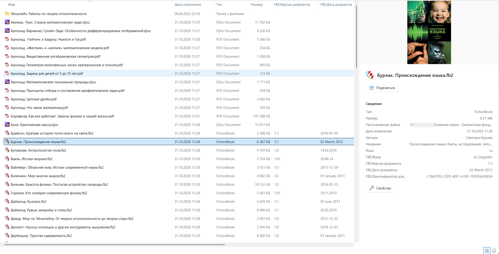

*Свойства FB2 в Проводнике*.

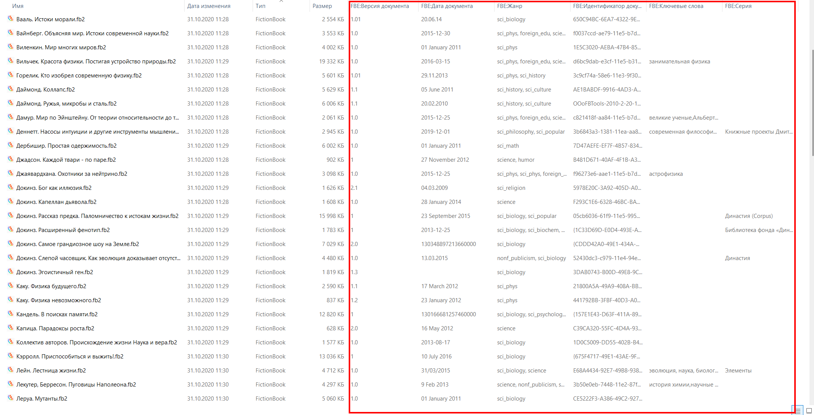

*Колонки Проводника с метаданными FB2*.

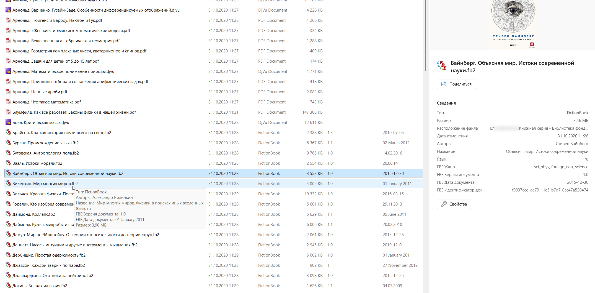

*Всплывающая подсказка FB2 в Проводнике*.

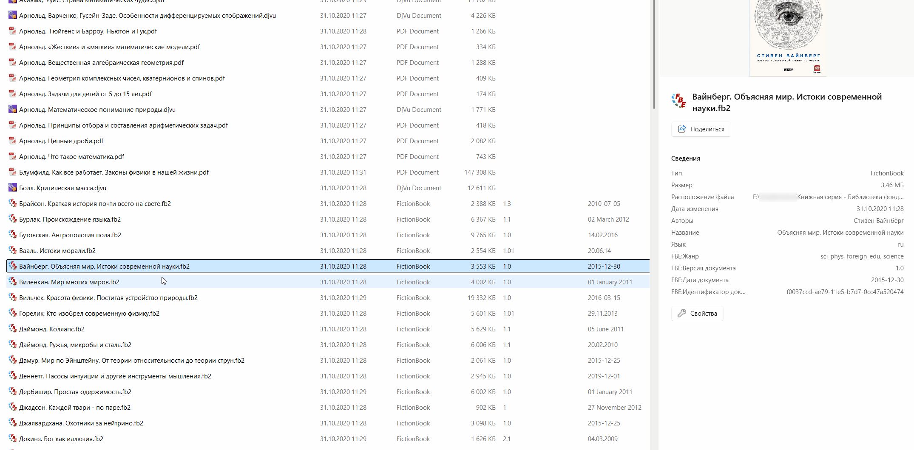

*Анимированная демонстрация всплывающей подсказки FB2*.

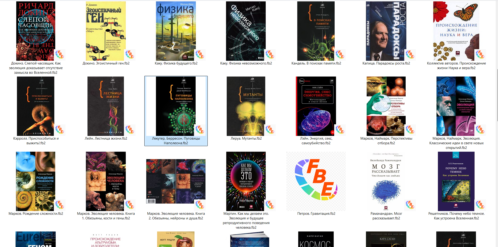

*Миниатюры обложек FB2 в Проводнике*.


*Команда проверки FB2 в контекстном меню*.

</details>

<details>
<summary><strong>Импорт и экспорт DOCX/EPUB</strong> — 6 изображений</summary>

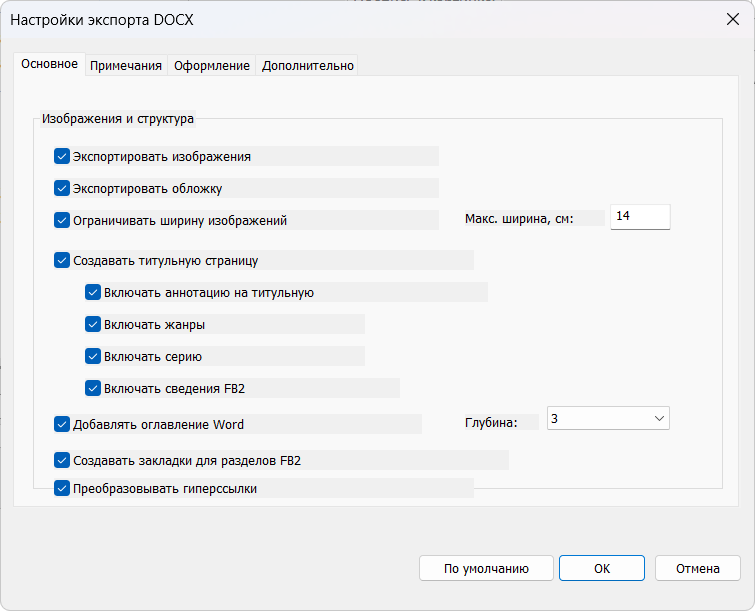

*Параметры экспорта DOCX — окно 1*.

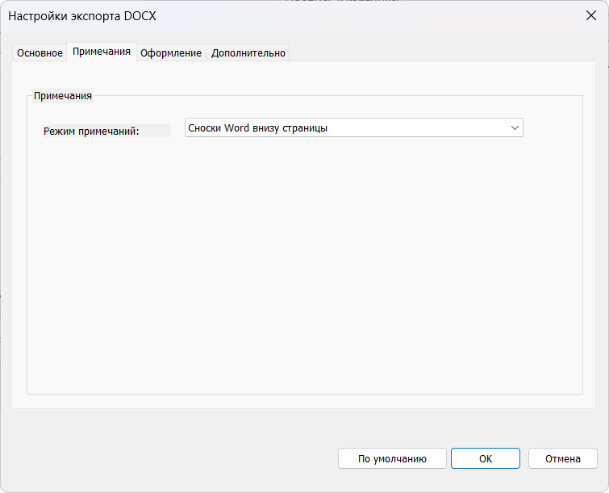

*Параметры экспорта DOCX — окно 2*.

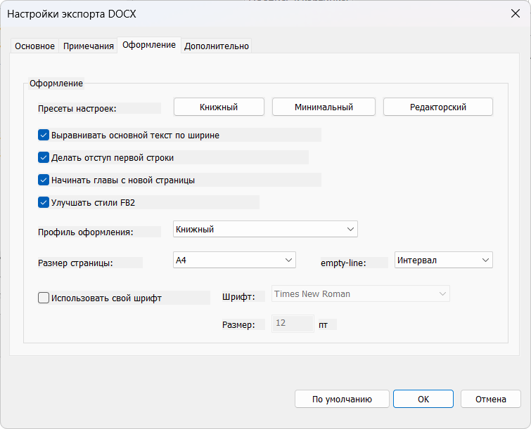

*Параметры экспорта DOCX — окно 3*.

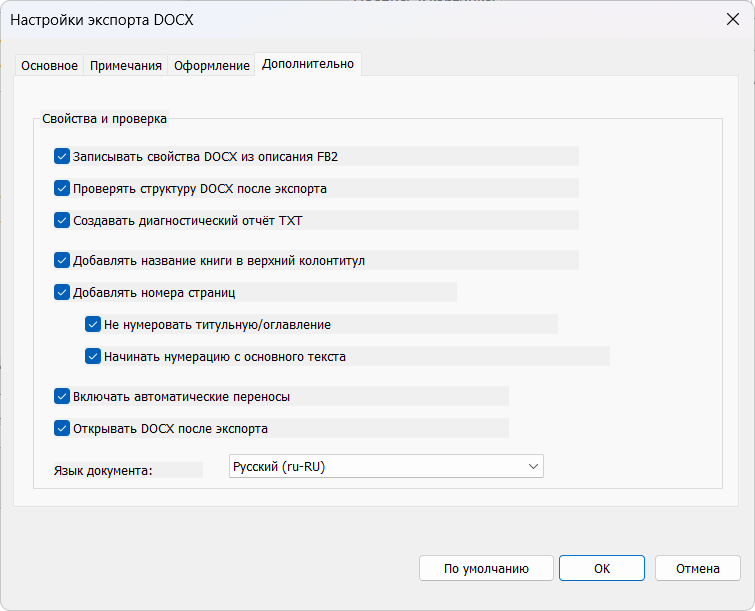

*Параметры экспорта DOCX — окно 4*.

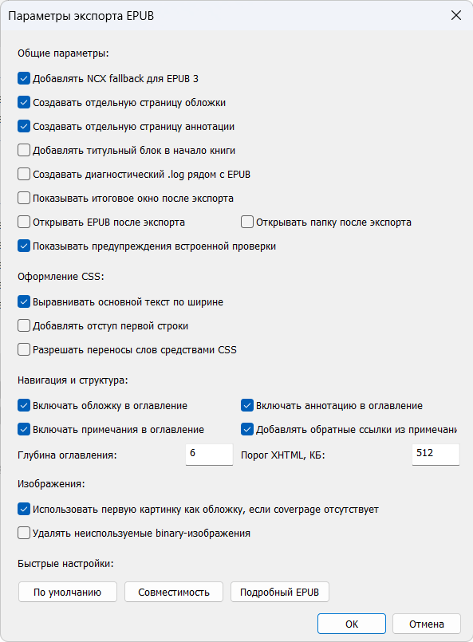

*Настройки экспорта EPUB*.

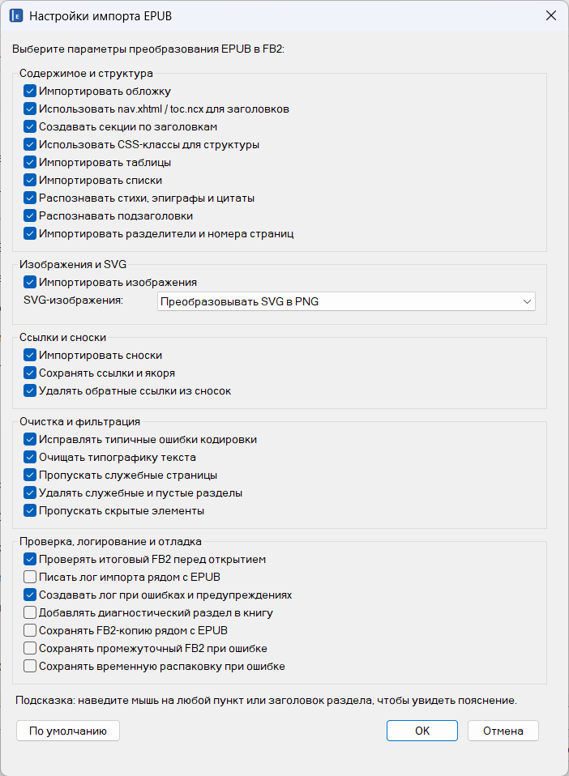

*Настройки импорта EPUB*.

</details>

<details>
<summary><strong>Пакетные конвертеры</strong> — 3 изображения</summary>

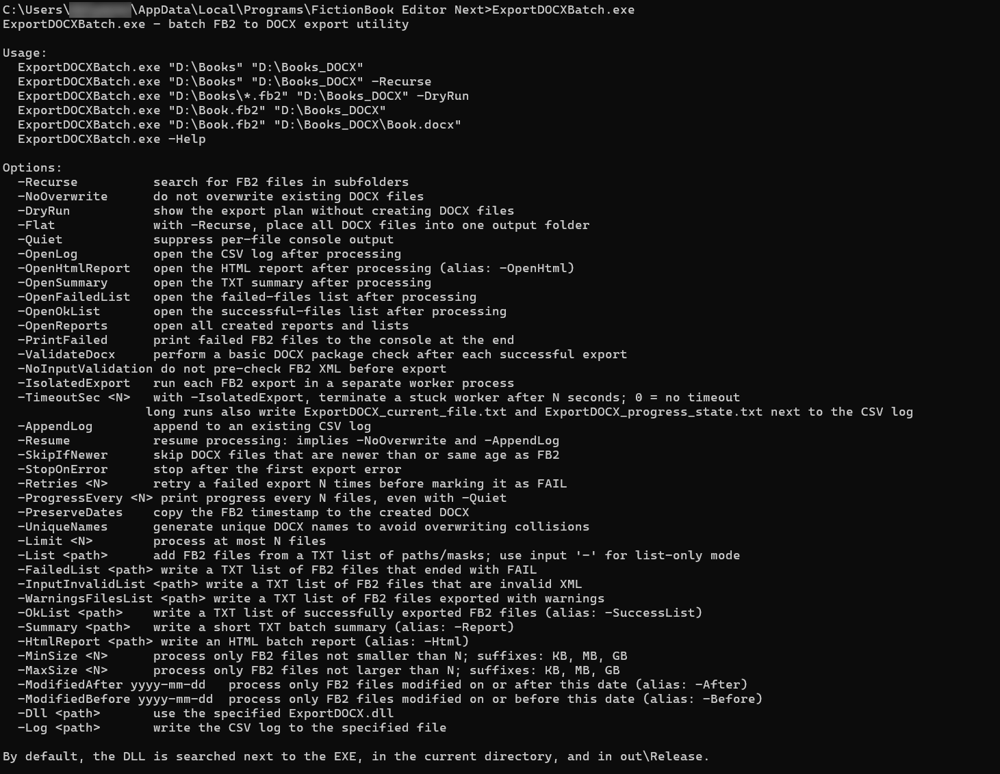

*Пакетный экспорт DOCX*.

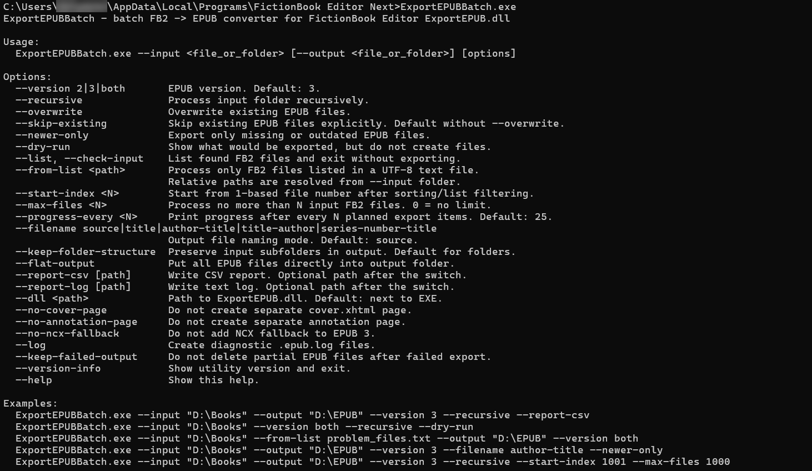

*Пакетный экспорт EPUB*.

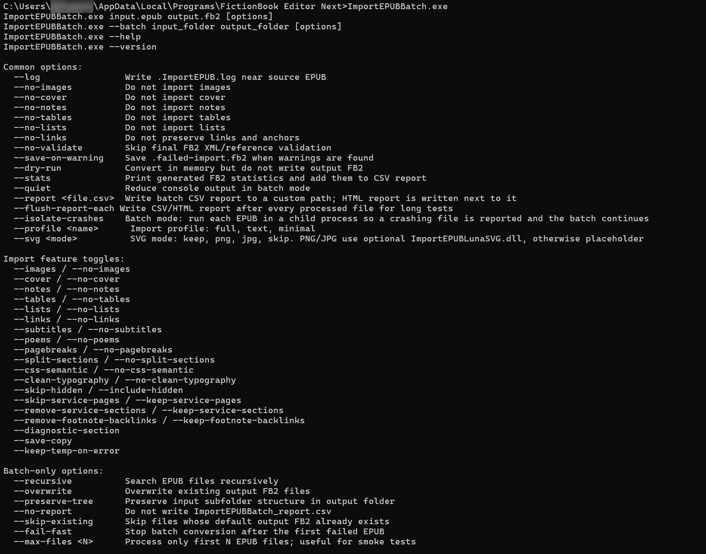

*Пакетный импорт EPUB*.

</details>

<details>
<summary><strong>Установка, сохранение и выбор языка</strong> — 3 изображения</summary>

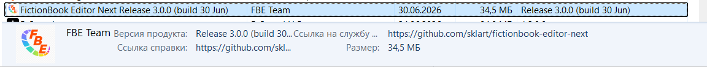

*Программа в списке установленных приложений*.

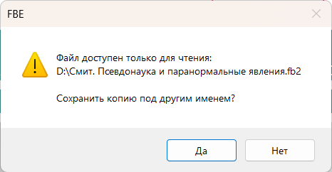

*Предупреждение при сохранении файла только для чтения*.


*Ранее опубликованный пример переключения языка интерфейса*.

</details>

## Совместимость с Windows

FBE Next — **32-разрядное приложение Win32** для Windows. В проекте поддерживается совместимость с Windows 7 SP1 на уровне целевых API и сборки; современная функциональность DPI и оформление применяются с учётом возможностей установленной системы.

| Система | Статус |
| --- | --- |
| **Windows 11 / Windows 10** | Основная среда современного использования и проверок. |
| **Windows 8.1** | Учитывается существующей политикой совместимости Win32. |
| **Windows 7 SP1** | Совместимость сохраняется как целевая, но **полные ручные испытания официальной 3.0.10 на реальной Windows 7 не подтверждены**. Требуются системные обновления и соответствующие runtime-компоненты. |
| **Windows Vista / Windows XP** | Не поддерживаются стандартной сборкой Next. |

В 3.0.10 опубликованы **единые** `win32`-пакеты без отдельного архива с `win7` в имени. Старые релизы содержали как специальные сборки, так и совместимые дубликаты под отдельными именами; ориентируйтесь на фактические файлы [конкретного выпуска](https://github.com/sklart/fictionbook-editor-next/releases/tag/v3.0.10), а не на старые инструкции по именованию.

## История развития

FBE Next — продолжение, а не переписывание оригинального FictionBook Editor с нуля. Основные этапы, отражённые в [истории выпусков](https://github.com/sklart/fictionbook-editor-next/releases):

| Выпуск | Главное для пользователя |
| --- | --- |
| [**3.0.0**](https://github.com/sklart/fictionbook-editor-next/releases/tag/v3.0.0) | Старт ветки Next; импорт EPUB, экспорт DOCX/EPUB, batch-конвертеры, обновлённые валидатор и интеграция с Проводником. |
| [**3.0.1–3.0.4**](https://github.com/sklart/fictionbook-editor-next/releases/tag/v3.0.4) | Исправления установщика и обновлений, гибкие компоненты shell-интеграции, работа над Windows 7. |
| [**3.0.5**](https://github.com/sklart/fictionbook-editor-next/releases/tag/v3.0.5) | Единая локализация на 12 языков, переключение языка во время работы, изоляция пользовательских данных Next. |
| [**3.0.6**](https://github.com/sklart/fictionbook-editor-next/releases/tag/v3.0.6) | Улучшения переключения «Тело»/«Код», резервные `.bak`, диагностика скриптов, дополнительные настройки. |
| [**3.0.7**](https://github.com/sklart/fictionbook-editor-next/releases/tag/v3.0.7) | XML-автодополнение, визуальные таблицы, новые форматы изображений, FBD, сохранность бинарных объектов. |
| [**3.0.8 RC1/RC2**](https://github.com/sklart/fictionbook-editor-next/releases/tag/v3.0.8-rc2) | Portable-режим и обновления, переработанное окно настроек, подсказки примечаний, строка состояния и современные диалоги. |
| [**3.0.9**](https://github.com/sklart/fictionbook-editor-next/releases/tag/v3.0.9) | Новый поиск, темы интерфейса, архивы ZIP, управление скриптами, проверка качества FB2, расширенный HTML-экспорт, надёжность Undo и диагностика. |
| [**3.0.10**](https://github.com/sklart/fictionbook-editor-next/releases/tag/v3.0.10) | Исправления тем и меню, закрытия и замены книги, Undo и сохранения; API скриптов 1.5.0 и улучшения импорта EPUB. |

Полная техническая история содержится в [CHANGELOG.md](CHANGELOG.md). Для проверки изменений между версиями используйте раздел **Compare** на GitHub.

## Сборка из исходников

Для сборки требуются Windows, **Visual Studio 2022** с компонентами разработки на C++ (v143, VC Tools 14.44), Windows SDK и **PowerShell 7**. Для сборки установщика нужен NSIS. Windows 7 — целевая среда запуска готового приложения, а не среда разработки.

```powershell
git clone --recurse-submodules https://github.com/sklart/fictionbook-editor-next.git
cd fictionbook-editor-next

.\tools\build\build.ps1 -Configuration Release -Platform Win32 -SkipUpx
.\tools\build\verify-release.ps1 -Configuration Release
```

Для полной проверки перед выпуском применяется отдельный релизный контур; запускать его после каждой небольшой правки не требуется. Собранные бинарники размещаются в `out/Release`, пакетные артефакты — в `out/artifacts` после упаковки.

**Документация для разработчиков:**

- [Сборка и тестирование](docs/building.md)
- [Релизный чек-лист](docs/release-checklist.md)
- [Система версий и обновлений](docs/versioning.md)
- [Архитектура и документация](docs/README.md)
- [API пользовательских скриптов](docs/scripting-api.md)
- [Регулярные выражения и тестовые сценарии](docs/testing/regex-regression.md)
- [Локализация](docs/reference/localization.md)
- [Карта тестов](docs/test-contours.md)

## Обратная связь и участие

Об ошибках и предложениях сообщайте в [GitHub Issues](https://github.com/sklart/fictionbook-editor-next/issues). Прежде чем отправлять отчёт, ознакомьтесь с [инструкцией](docs/reporting-issues.md): укажите версию FBE Next, выпуск Windows, тип установки, последовательность действий и ожидаемый результат. При необходимости приложите диагностический пакет и минимальную тестовую книгу.

Вопросы по историческим скриптам и обсуждение развития редактора возможны также в [сообществе Fiction Book Editor](https://groups.google.com/g/fiction-book-editor).

Для предложений изменений кода используйте репозиторий проекта. При модернизации **важно сохранять поведение классических сценариев и не нарушать обратную совместимость без необходимости**.

## Лицензия и благодарности

FictionBook Editor Next распространяется на условиях **GNU GPL-3.0-or-later**. Смотрите [LICENSE](LICENSE), [текст GPL](runtime/gpl-3.0.txt), [NOTICE](NOTICE) и [перечень сторонних компонентов и лицензий](THIRD-PARTY-NOTICES.md). Комплектные архивы содержат лицензионные уведомления в `THIRD-PARTY-LICENSES`.

Проект развивает редактор FictionBook Editor, сохраняя уважение к оригинальным авторам, авторам скриптов и сообществу. Основные источники и история:

- [FictionBook Editor (sensboston)](https://github.com/sensboston/fictionbookeditor) — исторический исходный проект.
- [FictionBook Editor (evpobr)](https://github.com/evpobr/fictionbookeditor) — reference-форк, использованный для сверки отдельных реализаций.

Спасибо SeNS, LitRes, Mike Matsnev, Sclex, Takir, stokber, авторам скриптов, переводчикам, тестировщикам и всем участникам развития FictionBook Editor.
