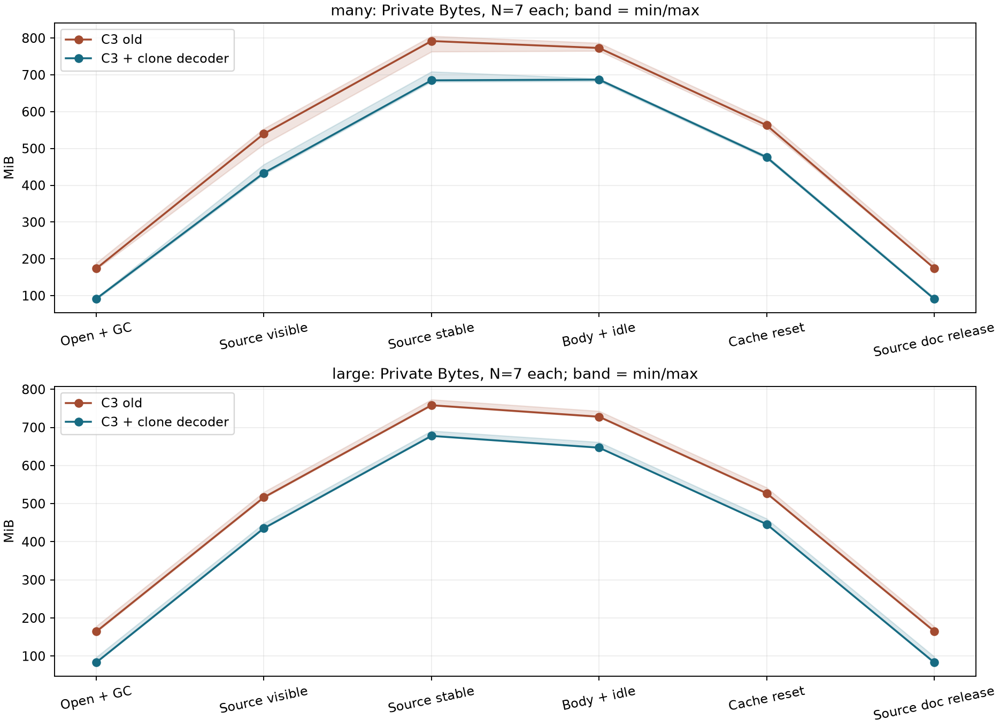

# C4.1 — XML/base64/Automation memory attribution

**STATUS: COMPLETE.** База C3: `2f0113b2566a3510c74e7e1c4536e9d10e4be0c8`.
Production fix принят коммитом `0b1b7d32fe75f41be037e1dc0ed675ed6d2a6e32`.
Acceptance tooling/documentation фиксируются отдельно; push не выполнялся.
Финальный `main.js` SHA-256: `EC80D417412CBFF6E3B6E1305B86B2FD407553402D81A1DB0AC3D83B53E8D1A1`.

После benchmark восстановлен исходный UTF-8 BOM (только три байта). Содержимое JS
без BOM побайтово совпадает с измеренным frozen snapshot SHA-256
`217199B8B552465DC4FF89AACEF83CBC2F964AF3F096F70BD4B50048147B54AE`.
Chain-of-custody: `out/perf/c41/source-format-finalization.json`; frozen snapshots
не менялись. Decoder regression на окончательном BOM-файле: 5 groups PASS.
Остальные final runtime/ASan/benchmark fingerprints относятся к идентичному JS без BOM.

## Результат

Основная постоянная избыточная память после Open оказалась UTF-16 содержимым
binary, интернированным MSXML при изменении `dataType` уже заполненного XML-узла.
Это не вторая decoded-копия BinaryStore. В Source добавляются XML DOM,
сериализованный текст и крупные буферы/кэши Scintilla.

В `PutBinaries` тип теперь устанавливается на пустом detached decoder, затем в
него клонируются child nodes исходного binary. `nodeTypedValue` возвращает тот же
SAFEARRAY; `finally` освобождает decoder. Входной XML не меняется. Клонирование
обходит промежуточную большую строку JScript/BSTR; **zero-copy не заявляется**.
COM/IDL, native ownership, BinaryStore metadata, Undo и vendor DLL не менялись.

Финальный targeted benchmark: **28/28 процессов PASS**, по 7 old/new на many/large,
**28/28 independent roundtrip equivalence PASS**, **700 state invariants PASS**.
Порядок вариантов и fixtures ротируется. Один native diagnostic Release EXE и два
frozen main.js; старый JS соответствует C3. Это новый memory contour, а не повтор
Baseline/C2/C3 benchmark. Исходные C3 9 warm-up / 63 measured остаются отдельным evidence.

Медианы MiB, 1 MiB = 1 048 576 bytes:

|Metric, MiB|many old → final|large old → final|
|---|---|---|
|Open + GC/idle Private|173.70 → 91.76 (-47.17%)|164.32 → 83.32 (-49.30%)|
|Open peak Private|270.48 → 207.02 (-23.46%)|285.53 → 205.09 (-28.17%)|
|Source stable Private|791.89 → 685.14 (-13.48%)|758.14 → 677.77 (-10.60%)|
|Body + idle Private|773.03 → 687.05 (-11.12%)|728.09 → 646.82 (-11.16%)|
|Max reported peak Private|1000.93 → 894.15 (-10.67%)|958.96 → 878.58 (-8.38%)|

**Private/Working Set/их peaks: регрессий median >5% в измеренных состояниях нет.**
Для many uncommitted reserve вырос: после Open 168.46 → 187.39 MiB (+11.24%),
в Source stable 166.38 → 196.74 MiB (+18.25%). Это отдельное отрицательное изменение,
не скрытое в Private Bytes: commit при этом снижается. После release Source document
many reserve остаётся около 536 MiB при Private около 91 MiB.

## Методика и границы точности

До начала сохранены HEAD/git status, tracked diff и SHA-256 20 856 файлов
в `out/perf/c41/baseline.json` / `working-tree-start.patch`. Исходная untracked
инфраструктура C4 дополнительно сохранена в `infrastructure-at-start`.
Финальный audit после resume: **23 407/23 407 SHA совпали**, включая все 2551
файла из исходной hash-ведомости Baseline/C2/C3 runtime snapshots. Все entries на месте.
Полный каталог дополнительных файлов вне исходной ведомости не выдаётся за проверенный стартовый census.
`docs/performance-binary-store-c4.md`, `out/perf/c4/**` и исходные C3 results сохранены.

Первоначальная атрибуция: по три полных timeline в отдельных процессах many/large;
ещё по три identical/unique и template keep/clear. Процесс сначала создаёт пустую
книгу, затем обычным LoadFile открывает fixture. Это **не** исторический CLI startup
Open из C4; числа разных контуров не подменяются друг другом.

Финальный Source-only contour содержит Open → GC/idle → image metadata/render →
Source generated/stable → Body → release XML/text caches → release Scintilla document →
Undo discard → before_close. Native/JS retain-all эксперименты в финальном contour
не повторяются. Verification Save выполняется **после всех измеряемых точек**.
Max reported peak означает OS peak до `before_close`, а не дополнительный Save.
Сами memory counters берутся до файлового I/O соответствующей точки.

Логические bytes, CString capacity, process deltas и requested heap bytes — разные
величины. Не суммировать их как независимые копии. `m_savedXml` и
`m_serializedSourceCache.xml` ссылаются на один cached DOM: два live-флага не дают два DOM.
Разности в основном анализе считаются внутри одного процесса. В final таблицах
даны ratio of medians и отдельная paired delta; p90 nearest-rank при N=7 равен max.

## Теория и измеренные представления

|Представление|many|large|Evidence|
|---|---:|---:|---|
|Canonical decoded bytes|32 768 000 / 31.250 MiB|31 507 926 / 30.048 MiB|exact native counters и независимые SHA|
|base64 characters|43 692 000|42 010 584|exact из fixtures|
|Только base64 UTF-16|87 384 000 / 83.336 MiB|84 021 168 / 80.129 MiB|exact logical, не отдельная heap allocation|
|XML `.xml` BSTR|87 479 730 / 83.427 MiB|84 037 458 / 80.144 MiB|exact actual length × 2|
|Source UTF-16 cache length|83.427 MiB|80.144 MiB|exact CString length|
|Source UTF-16 cache capacity|125.141 MiB|120.217 MiB|exact CString GetAllocLength|
|Source UTF-8 length|43 739 882 / 41.714 MiB|42 018 746 / 40.072 MiB|exact SCI_GETLENGTH|
|Native retained-all returned values|31.250 MiB|30.048 MiB|exact SAFEARRAY decoded sizes|
|JS retained-all values|31.250 MiB|30.048 MiB|logical reachable; физический JS layout отдельно не измерен|
|Native bitmap decoding|2 × 24 bytes|10 × 3 MiB|exact DIB pitch × height, cumulative events|
|Max single native bitmap|24 bytes|3 MiB|exact; cumulative 30 MiB не одновременно live|

large содержит **30.048 MiB**, а не 31.5 MiB decoded. Фактические XML UTF-8/UTF-16,
whitespace и размеры каждого binary сохранены в `representation-sizes.json`.

## Allocation-level experiment: корневые потребители

Выполнен один полный many timeline с Windows heap/VirtualAlloc ETW и приватными
маркерами. Heap tracing включён после initial empty document; startup allocations
до attach этим heap dataset не покрываются. `allocation-retry3/trace-stats.txt`:
**0 lost events, 0 lost buffers**. Из 49 native points 48 ETW markers: initial point
предшествует включению provider. Порядок одного потока и UTF-16 payload lengths
сверены; QPC residual сохранён, задержка EventWriteString не выдаётся за нулевую.

Первый `-images` вывод почти всё относил к WOW64. Полные x86 stacks сохранились:
для группировки удалён wrapper-prefix, использован первый caller module.
Все stack rows суммируются до GLOBAL outstanding с учётом 0.1 KiB округления.
`-range 0 T` использует микросекунды; это postprocessing **той же** ETL, не новые
эксперименты. См. [Microsoft xperf heap](https://learn.microsoft.com/en-us/windows-hardware/test/wpt/heap).

Ключевые стеки:

* Import: `MSXML6 DOMNode::put_dataType → Node::addID → Node::getContentAsName → Name::create → Atom::create → ArrayString::operator new`.
* XML text: `MSXML6 createTextNode → FB::CompactBinaryTextContent → FB::Doc::CreateDOMImp`.
* BSTR: `OLEAUT32 SysAllocStringLen → MSXML6 CachingStream::toBSTR / DOMNode::get_xml`, allocator в combase.
* Decoded values: `OLEAUT32 SafeArrayAllocData / SafeArrayCopy / VariantCopy`, allocator в combase.
* CString: `ATL::CWin32Heap::Reallocate → CSimpleStringT::SetString → SourceDocumentTransfer::PrepareSerializedSource`.
* Scintilla: модуль атрибутируется; private PDB функций отсутствует. Все 376.8 MiB нельзя назвать только текстом либо только layout cache.

### many: measured outstanding heap по состояниям, MiB, N=1 ETW

|State|MSXML6|COM alloc|Scintilla|FBE/ATL|MSHTML|JScript|Observed heap|Private|Unassigned|
|---|---|---|---|---|---|---|---|---|---|
|after_open_gc_idle|83.68|31.30|0.00|0.23|1.02|0.15|116.52|174.20|57.68|
|native_all_variants_live|83.68|62.57|0.00|0.31|1.02|0.15|147.87|201.61|53.74|
|js_all_retained|83.68|62.57|0.00|0.24|1.02|0.15|147.80|202.06|54.26|
|js_clear_after_gc|83.68|31.30|0.00|0.24|1.02|0.15|116.53|172.80|56.26|
|created_xml_dom_live_no_xml_getter|168.07|62.57|0.00|0.24|1.05|0.20|232.26|293.82|61.56|
|xml_dom_and_bstr_live|168.07|146.00|0.00|0.24|1.05|0.20|315.69|372.45|56.76|
|xml_release_after_idle|83.68|31.30|0.00|0.24|1.03|0.20|116.60|176.43|59.83|
|source_visible|168.07|62.57|125.15|125.40|1.07|0.20|482.59|540.66|58.06|
|body_after_readonly_source|167.26|31.30|376.80|125.56|1.08|0.20|702.31|772.25|69.94|
|source_xml_and_text_cache_released|83.68|31.30|378.02|0.42|1.08|0.20|494.81|563.98|69.17|
|source_scintilla_document_released|83.68|31.30|0.09|0.42|1.08|0.20|116.88|174.58|57.70|
|before_close|83.68|31.30|0.09|0.40|1.08|0.20|116.87|174.58|57.71|

После Open MSXML6 удерживает **83.68 MiB**, COM allocations — **31.30 MiB**.
В Source COM временно содержит ещё один decoded набор; после cleanup он уходит.
После Body MSXML6 ≈167.26 MiB — retained import representation плюс cached export DOM;
Source CString allocation ≈125.14 MiB и Scintilla ≈376.80 MiB.
Observed post-attach heap на Body ≈702.31 MiB из Private ≈772.25 MiB — около 91%.

**Unexplained/неразложенный остаток:** после Open 57.68 MiB, на Body около 69.94 MiB
между Private и observed post-attach heap. Он включает startup до attach, другие
виды private memory и allocator commit slack. Initial process был порядка 44 MiB,
но его нельзя просто вычесть как неизменный набор объектов. Остаток не объявляется
leak, размером DOM или reserve. Полного allocator committed-vs-used breakdown нет.

Для **large** отдельный allocation trace не снимался: physical MSXML/Scintilla split
остаётся **inferred**, а не exact. Измерены canonical 30.048 MiB, BSTR 80.144 MiB,
CString capacity 120.217 MiB, UTF-8 40.072 MiB и process deltas всех release.
Масштабирование UTF-16 base64 объясняет порядка 80 MiB retained overhead; это
поддерживается final old/new результатом, но не подменяет прямую heap attribution.
Всё сверх перечисленных точных logical counters у large не выдаётся за exact partition.

## Lifetime и Source

Native one/live/release, sequential all и retain-all разделены; сумма возвращённых
SAFEARRAY равна decoded bytes. Private delta иногда меньше logical bytes из-за
повторного использования committed страниц. JS discard/retain/clear/GC разделены:
очистка массива удаляет reachable references, освобождение может ждать GC.
Постоянная decoded-копия у getter не обнаружена.

CreateDOM измерен до `.xml`, затем DOM+BSTR, BSTR release с живым DOM,
DOM release, GC и idle. Освобождение COM pointer не гарантирует немедленного
снижения Private. В одном исходном many наблюдался выброс; min/max сохранены.

Source CString capacity превышает length примерно на **41.71/40.07 MiB**.
Причина видна в двух присваиваниях `PrepareSerializedSource`: сначала полный BSTR,
затем чуть более длинная строка после encoding declaration; ATL увеличивает capacity.
Это реальный native allocation, не ещё одна logical UTF-8 копия.

Scintilla растёт с ≈125.15 до ≈376.80 MiB. FBE устанавливает
`SCI_SETLAYOUTCACHE, SC_CACHE_DOCUMENT` (`SourceEditorControl.cpp:105`). Pinned
`PositionCache.cxx` создаёт line-layout chars, styles и float positions — около
6 bytes на UTF-8 byte при кэшировании всех строк. Для many 6 × 41.714 ≈250.3 MiB,
что согласуется с observed ростом ≈251.7 MiB. Это **inferred decomposition**,
не точное разбиение всех 1917 allocations несимволизированной группы.
Vendor/source cache policy в C4.1 не менялась.

Reset native Source caches убирает XML DOM и CString; замена Scintilla document
убирает почти всю оставшуюся Source память. Process delta около 388/362 MiB
связан с release document и callbacks; для large это не exact allocation size.
BinaryStore Undo history во всех 700 final states равен нулю. Это не доказательство
того, что внутри Source Scintilla нет своих text/style/undo buffers.

Native image decoding подсчитан отдельно от compressed payload. RebuildImagesInfo,
Body render, Source имеют собственные точки. MSHTML/GDI+ image caches этими DIB
counters не покрываются; они остаются third-party/unknown, особенно для large.

## Commit и reserve

PrivateUsage и PeakPagefileUsage — current/peak process commit, а не reserved
address space. MEM_PRIVATE/MEM_COMMIT и MEM_PRIVATE/MEM_RESERVE подсчитаны отдельно.
VirtualQuery MEM_PRIVATE commit не равен всему PrivateUsage: copy-on-write страницы
могут сохранять тип MEM_IMAGE/MEM_MAPPED. См. [PROCESS_MEMORY_COUNTERS_EX](https://learn.microsoft.com/en-us/windows/win32/api/psapi/ns-psapi-process_memory_counters_ex)
и [VirtualQuery](https://learn.microsoft.com/en-us/windows/win32/api/memoryapi/nf-memoryapi-virtualquery).
Разность этих counters также не является reserve. GC/HeapCompact/EmptyWorkingSet
не внедрялись как production fix; GC остаётся только диагностикой.

|Fixture|State|MEM_PRIVATE commit old|commit new|reserve old|reserve new|
|---|---|---|---|---|---|
|many|after_open_gc_idle|165.80|83.96|168.46|187.39|
|many|source_stable|782.26|673.05|166.38|196.74|
|many|before_close|166.61|83.26|532.03|536.37|
|large|after_open_gc_idle|155.69|75.61|82.82|82.23|
|large|source_stable|748.62|668.71|169.90|169.21|
|large|before_close|155.68|75.72|169.40|169.51|

## Отрицательные результаты и прерывание

* Очистка XSL template cache: по 3 keep/clear процесса; GC/idle median
  175.90 → 175.10 MiB, clear max 189.63 MiB. Ожидаемого освобождения ~80 MiB нет.
* Ранний release serialization BSTR: N=1 causal pilot каждого fixture уменьшает
  промежуточный Source peak, но не общий peak после поправки на pre-Source floor.
  Этот C++ вариант не внедрён; экспериментальная branch архивирована в local evidence и удалена из accepted source.
* Первый detached decoder с `decoder.text=original.text`: полноценные 28/28
  и equivalence PASS, steady улучшился, но Open peak Private **+14.90% many /
  +9.22% large** (paired median +10.08/+11.37%). Этот вариант **отклонён**.
  Полные результаты сохранены в `out/perf/c41/fix-benchmark`; это не final dataset.
* Final clone-node run получил `ERROR_DISK_FULL` при копировании XML после уже
  завершённого native PASS. На проверке было свободно ~12 GB; причина transient
  storage error не установлена. Удалений/очистки исходных evidence не потребовалось.
  Сохранены interrupted manifests. 25 runs были завершены сразу; ещё один native
  run восстановлен по полному report/XML с проверкой EXE/JS/input/output SHA;
  после validated resume выполнены только два недостающих large run. Итого
  28 уникальных native процессов; raw измерения не переписывались и не повторялись.

## Следующие точки оптимизации

|Потребитель|Класс|Потенциал и предел доказательства|
|---|---|---|
|Import MSXML Atom/base64|CAN OPTIMIZE NOW — FIXED|~80–84 MiB steady; final seven-repeat proof ниже|
|Canonical payload|ARCHITECTURAL LIMIT текущего контракта|31.25/30.05 MiB; не экономия decoded ownership|
|BinaryStore metadata|не основной потребитель|C4 ≈104 KiB/500; micro-optimization не решает Source footprint|
|Automation values / XML BSTR|TRANSIENT|+31.25/30.05 MiB retain-all; +83.4/80.1 MiB BSTR; lifetime/contract сохранять|
|CString excess capacity|CAN OPTIMIZE NOW, следующий отдельный fix|измеренный slack 41.71/40.07 MiB; снижение capacity/peak требует before/after, здесь не внедрено|
|Whole-document layout cache|THIRD-PARTY + policy candidate|many прирост Scintilla ≈251.7 MiB; bounded cache A/B требует scroll/search/selection/GUI проверки; гарантированная экономия не заявляется|
|Полный XML/UTF-16/UTF-8 Source|ARCHITECTURAL LIMIT текущего пути|несколько представлений неизбежны без отдельного redesign; их capacities и lifetime можно уменьшать отдельно|
|Native bitmap decode|TRANSIENT|many 48 bytes cumulative; large 30 MiB cumulative / 3 MiB max; не считать live cache|
|MSHTML images / process remainder|THIRD-PARTY / UNKNOWN|не объявлять reserve, leak либо точным размером XML|

## Verification и release boundary

Final clone-node JS: decoder regression **5 groups PASS** (valid/whitespace,
CDATA/comments, empty, malformed+continue, aggregation; input XML unchanged);
legacy **46/46**, bundled **6/6**, binary runtime load/cache/mutations/Undo/Redo/
save-reopen **PASS**; targeted ASan **2/2 PASS** на существующем ASan EXE с final JS,
без sanitizer rebuild. Native Release `/W4 /WX` **PASS**; после него менялся только JS
и compile-time-disabled diagnostic scenario. Нативный Release EXE не менялся.
Для нового fix повторялись только связанные проверки. C3 full three-way benchmark,
ASan FAST, UBSan и полный release/FullValidation pipeline не запускались.

Native Release EXE SHA-256: `0A763725F01AACFF6089578786C028C77FC4E825BB1B33945C401E4E5C725B38`.
Final ASan EXE SHA-256: `6DD1D49763F5802D48D5956AE27944520667118F10FECB8FBA376F55B558E0EC`.
Diagnostic builds имели известный MSB8028 shared intermediate warning; он не
скрывается под native `/W4 /WX` PASS. Публичный IDL и runtime Scintilla/Lexilla
не менялись. External OLE / FullValidation и manual GUI smoke остаются отдельными
pending gates. Push/commit не выполнялись.

## Diagnostic Open timing guard

Это duration native Open внутри memory harness, не выделенный C3 timing benchmark;
host не заявляется эксклюзивным. Приведены и отрицательные значения/разброс,
ускорение по этим duration не заявляется. Все значения ниже в ms, кроме Δ%.

|Fixture|Old median|New median|Old min…max|New min…max|Δ medians %|Paired median %|Paired min…max %|N each|
|---|---|---|---|---|---|---|---|---|
|many|4344|2250|1953…4718|1937…4219|-48.20|-23.04|-52.01…-0.82|7|
|large|2344|2047|1781…2922|1375…2531|-12.67|-13.81|-22.80…-1.25|7|

## Классификация C4/C4.1 файлов

Каждый изменённый/новый исходный файл и группы generated evidence классифицированы
ниже. KEEP у native instrumentation означает compile-time disabled, без ABI/API
и normal-runtime эффекта. DELETE — исключить из будущего commit; первоначальный
dirty CDB helper в этой сессии не удалялся, его исходная копия сохранена.
Generated `out` не добавляется в tracking. Исходные dirty C4 изменения не откатывались.

|File / group|Class|Reason|
|---|---|---|
|`docs/performance-binary-store-c3.md`|DOCUMENTATION|отчёт/графики; C3/C4 содержимое сохраняется|
|`runtime/main.js`|KEEP|минимальный production decoder fix|
|`src/fbe/FBDoc.cpp`|KEEP|C4/C4.1 compile-time diagnostics; default off, без ABI/API и normal-runtime эффекта|
|`src/fbe/binary/BinaryDocumentStore.inl`|KEEP|C4/C4.1 compile-time diagnostics; default off, без ABI/API и normal-runtime эффекта|
|`src/fbe/binary/BinaryPayloadStore.cpp`|KEEP|C4/C4.1 compile-time diagnostics; default off, без ABI/API и normal-runtime эффекта|
|`src/fbe/binary/BinaryPayloadStore.h`|KEEP|C4/C4.1 compile-time diagnostics; default off, без ABI/API и normal-runtime эффекта|
|`src/fbe/binary/BinaryStore.cpp`|KEEP|C4/C4.1 compile-time diagnostics; default off, без ABI/API и normal-runtime эффекта|
|`src/fbe/binary/BinaryStore.h`|KEEP|C4/C4.1 compile-time diagnostics; default off, без ABI/API и normal-runtime эффекта|
|`src/fbe/mainfrm.h`|KEEP|C4/C4.1 compile-time diagnostics; default off, без ABI/API и normal-runtime эффекта|
|`src/fbe/scripts/ScriptBinaryDocument.h`|KEEP|C4/C4.1 compile-time diagnostics; default off, без ABI/API и normal-runtime эффекта|
|`src/fbe/source/SourceDocumentTransfer.cpp`|KEEP|C4/C4.1 compile-time diagnostics; default off, без ABI/API и normal-runtime эффекта|
|`src/fbe/source/SourceViewSession.cpp`|KEEP|C4/C4.1 compile-time diagnostics; default off, без ABI/API и normal-runtime эффекта|
|`src/fbe/source/SourceViewSession.h`|KEEP|C4/C4.1 compile-time diagnostics; default off, без ABI/API и normal-runtime эффекта|
|`src/fbe/testing/RuntimeTestScenarios.inl`|KEEP|C4/C4.1 compile-time diagnostics; default off, без ABI/API и normal-runtime эффекта|
|`src/fbe/utils/Utils.cpp`|KEEP|C4/C4.1 compile-time diagnostics; default off, без ABI/API и normal-runtime эффекта|
|`tools/perf/binary-store-driver.cpp`|KEEP|повторяемый affected regression/performance/analysis tool|
|`docs/performance-assets/binary-store-c4-scaling.png`|DOCUMENTATION|отчёт/графики; C3/C4 содержимое сохраняется|
|`docs/performance-assets/c41-fix-memory-lifetime.png`|DOCUMENTATION|отчёт/графики; C3/C4 содержимое сохраняется|
|`docs/performance-binary-store-c4-memory-attribution.md`|DOCUMENTATION|отчёт/графики; C3/C4 содержимое сохраняется|
|`docs/performance-binary-store-c4.md`|DOCUMENTATION|отчёт/графики; C3/C4 содержимое сохраняется|
|`src/fbe/binary/BinaryDiagnostics.h`|KEEP|C4/C4.1 compile-time diagnostics; default off, без ABI/API и normal-runtime эффекта|
|`src/fbe/binary/BinaryMemoryAttribution.h`|KEEP|C4/C4.1 compile-time diagnostics; default off, без ABI/API и normal-runtime эффекта|
|`src/fbe/binary/BinaryPayloadDiagnostics.h`|KEEP|C4/C4.1 compile-time diagnostics; default off, без ABI/API и normal-runtime эффекта|
|`src/fbe/testing/RuntimeTestBinaryStoreC4.inl`|KEEP|C4/C4.1 compile-time diagnostics; default off, без ABI/API и normal-runtime эффекта|
|`src/fbe/testing/RuntimeTestBinaryStoreC41.inl`|KEEP|C4/C4.1 compile-time diagnostics; default off, без ABI/API и normal-runtime эффекта|
|`tools/perf/__pycache__/analyze-binary-store-c41-allocations.cpython-314.pyc`|KEEP|повторяемый affected regression/performance/analysis tool|
|`tools/perf/__pycache__/analyze-binary-store-c41-fix.cpython-314.pyc`|KEEP|повторяемый affected regression/performance/analysis tool|
|`tools/perf/__pycache__/analyze-binary-store-c41.cpython-314.pyc`|KEEP|повторяемый affected regression/performance/analysis tool|
|`tools/perf/__pycache__/check-binary-store-c41-roundtrip.cpython-314.pyc`|KEEP|повторяемый affected regression/performance/analysis tool|
|`tools/perf/analyze-binary-store-c4.py`|KEEP|повторяемый affected regression/performance/analysis tool|
|`tools/perf/analyze-binary-store-c41-allocations.py`|KEEP|повторяемый affected regression/performance/analysis tool|
|`tools/perf/analyze-binary-store-c41-fix.py`|KEEP|повторяемый affected regression/performance/analysis tool|
|`tools/perf/analyze-binary-store-c41.py`|KEEP|повторяемый affected regression/performance/analysis tool|
|`tools/perf/binary-store-c4-driver.cpp`|KEEP|повторяемый affected regression/performance/analysis tool|
|`tools/perf/binary-store-c4-open-profile.js`|KEEP|повторяемый affected regression/performance/analysis tool|
|`tools/perf/binary-store-c4-profile-driver.cpp`|KEEP|повторяемый affected regression/performance/analysis tool|
|`tools/perf/binary-store-c4-runtime-profile.js`|KEEP|повторяемый affected regression/performance/analysis tool|
|`tools/perf/build-binary-store-c4-diagnostic.ps1`|KEEP|повторяемый affected regression/performance/analysis tool|
|`tools/perf/build-binary-store-c41-diagnostic.ps1`|KEEP|повторяемый affected regression/performance/analysis tool|
|`tools/perf/check-binary-store-c41-roundtrip.py`|KEEP|повторяемый affected regression/performance/analysis tool|
|`tools/perf/inspect-binary-store-c4-heaps.ps1`|DELETE before a future commit|непринятый CDB one-off; исходная копия сохранена в infrastructure-at-start|
|`tools/perf/invoke-binary-store-c41-allocation.ps1`|KEEP|повторяемый affected regression/performance/analysis tool|
|`tools/perf/run-binary-store-c4-experiment.ps1`|KEEP|повторяемый affected regression/performance/analysis tool|
|`tools/perf/run-binary-store-c4-probe.ps1`|KEEP|повторяемый affected regression/performance/analysis tool|
|`tools/perf/run-binary-store-c4-scaling.ps1`|KEEP|повторяемый affected regression/performance/analysis tool|
|`tools/perf/run-binary-store-c41-fix-benchmark.ps1`|KEEP|повторяемый affected regression/performance/analysis tool|
|`tools/perf/run-binary-store-c41-probe.ps1`|KEEP|повторяемый affected regression/performance/analysis tool|
|`tools/tests/test-binary-import-decoder.ps1`|KEEP|повторяемый affected regression/performance/analysis tool|
|`out/perf/c4/**`|DOCUMENTATION|исходное immutable C4 evidence|
|`out/perf/c41/**`|DOCUMENTATION|generated raw/negative/interrupted/frozen evidence; не tracked configuration|
|`out/perf/results-2f0113b2-final64-uiwait/**`|DOCUMENTATION|исходный C3 benchmark, не повторялся|

## Полные численные приложения

Первое приложение — исходная C3 атрибуция N=3 с полными lifetime/Automation
состояниями. Второе — **окончательный clone-node** old/new N=7; пути к raw data
различаются намеренно. Дополнительные reserves, counters и paired differences
сохранены в JSON, включая нулевые history и все 700 state checks.

## Численные приложения C4.1

### Фактические размеры входных представлений (bytes)

| Fixture | Decoded | base64 chars | base64 UTF-16 | File UTF-8 | Fixture XML UTF-16 |
|---|---|---|---|---|---|
| control | 16384 | 21856 | 43712 | 28900 | 57800 |
| many | 32768000 | 43692000 | 87384000 | 43737660 | 87475320 |
| large | 31507926 | 42010584 | 84021168 | 42017994 | 84035988 |
| many-identical | 32768000 | 43692000 | 87384000 | 43737660 | 87475320 |
| many-unique | 32768000 | 43692000 | 87384000 | 43737660 | 87475320 |

### many: три отдельных процесса, медианы MiB

Private/WS/peaks — process counters; logical columns не являются полным heap breakdown.

Point bytes — локальный scope hook (BSTR или UTF-8 vector по имени состояния); это отдельное измерение, не дополнительная независимая копия.

| State | Canonical | History | Local XML BSTR | Point bytes | UTF16 cache | Source UTF8 | Native values | JS reachable | Private | WS | Peak Private | Peak WS |
|---|---|---|---|---|---|---|---|---|---|---|---|---|
| process_initialized | 0.00 | 0.00 | 0.00 | 0.00 | 0.00 | 0.00 | 0.00 | 0.00 | 44.43 | 78.06 | 44.62 | 78.18 |
| after_open | 31.25 | 0.00 | 0.00 | 0.00 | 0.00 | 0.00 | 0.00 | 0.00 | 181.00 | 214.32 | 292.10 | 324.86 |
| after_open_gc | 31.25 | 0.00 | 0.00 | 0.00 | 0.00 | 0.00 | 0.00 | 0.00 | 177.01 | 210.61 | 292.10 | 324.86 |
| after_open_gc_idle | 31.25 | 0.00 | 0.00 | 0.00 | 0.00 | 0.00 | 0.00 | 0.00 | 176.75 | 210.26 | 292.10 | 324.86 |
| before_native_one | 31.25 | 0.00 | 0.00 | 0.00 | 0.00 | 0.00 | 0.00 | 0.00 | 176.81 | 210.45 | 292.10 | 324.86 |
| native_one_variant_live | 31.25 | 0.00 | 0.00 | 0.00 | 0.00 | 0.00 | 0.06 | 0.00 | 176.81 | 210.53 | 292.10 | 324.86 |
| native_one_variant_released | 31.25 | 0.00 | 0.00 | 0.00 | 0.00 | 0.00 | 0.00 | 0.00 | 176.81 | 210.53 | 292.10 | 324.86 |
| native_one_after_gc | 31.25 | 0.00 | 0.00 | 0.00 | 0.00 | 0.00 | 0.00 | 0.00 | 176.73 | 210.45 | 292.10 | 324.86 |
| native_all_sequential_released | 31.25 | 0.00 | 0.00 | 0.00 | 0.00 | 0.00 | 0.00 | 0.00 | 176.73 | 210.45 | 292.10 | 324.86 |
| native_all_variants_live | 31.25 | 0.00 | 0.00 | 0.00 | 0.00 | 0.00 | 31.25 | 0.00 | 203.39 | 237.14 | 292.10 | 324.86 |
| native_all_variants_released | 31.25 | 0.00 | 0.00 | 0.00 | 0.00 | 0.00 | 0.00 | 0.00 | 176.24 | 210.20 | 292.10 | 324.86 |
| native_all_after_gc | 31.25 | 0.00 | 0.00 | 0.00 | 0.00 | 0.00 | 0.00 | 0.00 | 176.27 | 210.21 | 292.10 | 324.86 |
| native_all_after_idle | 31.25 | 0.00 | 0.00 | 0.00 | 0.00 | 0.00 | 0.00 | 0.00 | 176.29 | 210.21 | 292.10 | 324.86 |
| js_no_extra_access | 31.25 | 0.00 | 0.00 | 0.00 | 0.00 | 0.00 | 0.00 | 0.00 | 176.36 | 210.25 | 292.10 | 324.86 |
| js_one_discarded | 31.25 | 0.00 | 0.00 | 0.00 | 0.00 | 0.00 | 0.00 | 0.00 | 176.41 | 210.32 | 292.10 | 324.86 |
| js_all_discarded | 31.25 | 0.00 | 0.00 | 0.00 | 0.00 | 0.00 | 0.00 | 0.00 | 203.32 | 237.13 | 292.10 | 324.86 |
| js_discard_after_gc | 31.25 | 0.00 | 0.00 | 0.00 | 0.00 | 0.00 | 0.00 | 0.00 | 176.33 | 210.08 | 292.10 | 324.86 |
| js_all_retained | 31.25 | 0.00 | 0.00 | 0.00 | 0.00 | 0.00 | 0.00 | 31.25 | 202.92 | 236.80 | 292.10 | 324.86 |
| js_array_cleared | 31.25 | 0.00 | 0.00 | 0.00 | 0.00 | 0.00 | 0.00 | 0.00 | 202.92 | 236.80 | 292.10 | 324.86 |
| js_clear_after_gc | 31.25 | 0.00 | 0.00 | 0.00 | 0.00 | 0.00 | 0.00 | 0.00 | 175.99 | 210.09 | 292.10 | 324.86 |
| js_clear_after_idle | 31.25 | 0.00 | 0.00 | 0.00 | 0.00 | 0.00 | 0.00 | 0.00 | 175.95 | 210.02 | 292.10 | 324.86 |
| before_create_dom | 31.25 | 0.00 | 0.00 | 0.00 | 0.00 | 0.00 | 0.00 | 0.00 | 175.95 | 210.02 | 292.10 | 324.86 |
| created_xml_dom_live_no_xml_getter | 31.25 | 0.00 | 0.00 | 0.00 | 0.00 | 0.00 | 0.00 | 0.00 | 273.64 | 306.89 | 292.10 | 324.86 |
| xml_dom_and_bstr_live | 31.25 | 0.00 | 83.43 | 0.00 | 0.00 | 0.00 | 0.00 | 0.00 | 351.40 | 385.46 | 441.93 | 472.95 |
| xml_bstr_released_dom_live | 31.25 | 0.00 | 0.00 | 0.00 | 0.00 | 0.00 | 0.00 | 0.00 | 267.80 | 302.03 | 441.93 | 472.95 |
| xml_dom_released | 31.25 | 0.00 | 0.00 | 0.00 | 0.00 | 0.00 | 0.00 | 0.00 | 267.80 | 302.03 | 441.93 | 472.95 |
| xml_release_after_gc | 31.25 | 0.00 | 0.00 | 0.00 | 0.00 | 0.00 | 0.00 | 0.00 | 176.24 | 210.55 | 441.93 | 472.95 |
| xml_release_after_idle | 31.25 | 0.00 | 0.00 | 0.00 | 0.00 | 0.00 | 0.00 | 0.00 | 176.07 | 210.39 | 441.93 | 472.95 |
| after_rebuild_images_info | 31.25 | 0.00 | 0.00 | 0.00 | 0.00 | 0.00 | 0.00 | 0.00 | 176.45 | 210.80 | 441.93 | 472.95 |
| after_body_render_idle | 31.25 | 0.00 | 0.00 | 0.00 | 0.00 | 0.00 | 0.00 | 0.00 | 175.88 | 210.23 | 441.93 | 472.95 |
| before_source_gc | 31.25 | 0.00 | 0.00 | 0.00 | 0.00 | 0.00 | 0.00 | 0.00 | 175.82 | 210.18 | 441.93 | 472.95 |
| source_cached_dom_created | 31.25 | 0.00 | 0.00 | 0.00 | 0.00 | 0.00 | 0.00 | 0.00 | 295.63 | 328.47 | 441.93 | 472.95 |
| source_serialization_bstr_live | 31.25 | 0.00 | 0.00 | 83.43 | 0.00 | 0.00 | 0.00 | 0.00 | 372.84 | 406.57 | 464.44 | 495.08 |
| source_serialization_bstr_released | 31.25 | 0.00 | 0.00 | 0.00 | 83.43 | 0.00 | 0.00 | 0.00 | 414.63 | 406.61 | 790.84 | 740.35 |
| source_utf8_vector_live | 31.25 | 0.00 | 0.00 | 41.71 | 83.43 | 0.00 | 0.00 | 0.00 | 456.43 | 448.34 | 790.84 | 740.35 |
| source_scintilla_and_utf8_vector_live | 31.25 | 0.00 | 0.00 | 41.71 | 83.43 | 41.71 | 0.00 | 0.00 | 581.82 | 573.50 | 790.84 | 740.35 |
| source_utf8_vector_released | 31.25 | 0.00 | 0.00 | 0.00 | 83.43 | 41.71 | 0.00 | 0.00 | 540.02 | 531.78 | 790.84 | 740.35 |
| source_visible | 31.25 | 0.00 | 0.00 | 0.00 | 83.43 | 41.71 | 0.00 | 0.00 | 541.53 | 532.66 | 790.84 | 740.35 |
| source_stable | 31.25 | 0.00 | 0.00 | 0.00 | 83.43 | 41.71 | 0.00 | 0.00 | 793.77 | 784.15 | 793.77 | 784.15 |
| body_after_readonly_source | 31.25 | 0.00 | 0.00 | 0.00 | 83.43 | 41.71 | 0.00 | 0.00 | 774.01 | 764.84 | 1002.77 | 992.75 |
| body_after_source_gc | 31.25 | 0.00 | 0.00 | 0.00 | 83.43 | 41.71 | 0.00 | 0.00 | 772.79 | 763.59 | 1002.77 | 992.75 |
| body_after_source_idle | 31.25 | 0.00 | 0.00 | 0.00 | 83.43 | 41.71 | 0.00 | 0.00 | 774.50 | 765.09 | 1002.77 | 992.75 |
| source_xml_and_text_cache_released | 31.25 | 0.00 | 0.00 | 0.00 | 0.00 | 41.71 | 0.00 | 0.00 | 564.89 | 597.45 | 1002.77 | 992.75 |
| source_scintilla_document_released | 31.25 | 0.00 | 0.00 | 0.00 | 0.00 | 0.00 | 0.00 | 0.00 | 176.45 | 210.10 | 1002.77 | 992.75 |
| source_release_after_gc | 31.25 | 0.00 | 0.00 | 0.00 | 0.00 | 0.00 | 0.00 | 0.00 | 176.45 | 210.11 | 1002.77 | 992.75 |
| source_release_after_idle | 31.25 | 0.00 | 0.00 | 0.00 | 0.00 | 0.00 | 0.00 | 0.00 | 176.48 | 210.11 | 1002.77 | 992.75 |
| after_undo_discard | 31.25 | 0.00 | 0.00 | 0.00 | 0.00 | 0.00 | 0.00 | 0.00 | 176.50 | 210.11 | 1002.77 | 992.75 |
| after_undo_discard_gc | 31.25 | 0.00 | 0.00 | 0.00 | 0.00 | 0.00 | 0.00 | 0.00 | 176.50 | 210.11 | 1002.77 | 992.75 |
| before_close | 31.25 | 0.00 | 0.00 | 0.00 | 0.00 | 0.00 | 0.00 | 0.00 | 176.50 | 210.11 | 1002.77 | 992.75 |

### many: paired Private deltas, MiB (after−before), N=3

Каждая разность вычислена внутри одного процесса; это не точный размер объекта.

| Pair | median | p90 | min | max | N |
|---|---|---|---|---|---|
| open_minus_initialized | 135.84 | 136.57 | 135.76 | 136.57 | 3 |
| open_gc_minus_initialized | 131.50 | 132.35 | 131.42 | 132.35 | 3 |
| native_one | 0.00 | 0.05 | 0.00 | 0.05 | 3 |
| native_all_retained | 26.75 | 26.79 | 26.61 | 26.79 | 3 |
| native_all_release | -26.95 | -26.84 | -27.14 | -26.84 | 3 |
| js_all_retained | 26.59 | 26.85 | 26.34 | 26.85 | 3 |
| js_logical_clear | 0.00 | 0.00 | 0.00 | 0.00 | 3 |
| js_clear_gc | -26.90 | -26.85 | -26.93 | -26.85 | 3 |
| create_dom | 97.69 | 98.38 | 97.68 | 98.38 | 3 |
| xml_bstr | 77.85 | 78.74 | 77.76 | 78.74 | 3 |
| bstr_release | -83.60 | -83.59 | -83.60 | -83.59 | 3 |
| dom_release | 0.00 | 0.00 | 0.00 | 0.00 | 3 |
| xml_gc | -91.30 | -7.73 | -91.56 | -7.73 | 3 |
| xml_idle | -0.19 | -0.17 | -0.20 | -0.17 | 3 |
| source_visible | 364.92 | 365.71 | 364.59 | 365.71 | 3 |
| return_body | -19.39 | -19.16 | -19.81 | -19.16 | 3 |
| source_cache_release | -209.82 | -209.38 | -210.14 | -209.38 | 3 |
| scintilla_doc_release | -388.11 | -388.09 | -388.45 | -388.09 | 3 |
| source_release_gc | 0.00 | 0.00 | -0.00 | 0.00 | 3 |
| source_release_idle | 0.01 | 0.04 | 0.01 | 0.04 | 3 |

### large: три отдельных процесса, медианы MiB

Private/WS/peaks — process counters; logical columns не являются полным heap breakdown.

Point bytes — локальный scope hook (BSTR или UTF-8 vector по имени состояния); это отдельное измерение, не дополнительная независимая копия.

| State | Canonical | History | Local XML BSTR | Point bytes | UTF16 cache | Source UTF8 | Native values | JS reachable | Private | WS | Peak Private | Peak WS |
|---|---|---|---|---|---|---|---|---|---|---|---|---|
| process_initialized | 0.00 | 0.00 | 0.00 | 0.00 | 0.00 | 0.00 | 0.00 | 0.00 | 49.57 | 78.00 | 49.77 | 78.12 |
| after_open | 30.05 | 0.00 | 0.00 | 0.00 | 0.00 | 0.00 | 0.00 | 0.00 | 169.96 | 206.61 | 279.63 | 295.49 |
| after_open_gc | 30.05 | 0.00 | 0.00 | 0.00 | 0.00 | 0.00 | 0.00 | 0.00 | 168.94 | 205.91 | 279.63 | 295.49 |
| after_open_gc_idle | 30.05 | 0.00 | 0.00 | 0.00 | 0.00 | 0.00 | 0.00 | 0.00 | 168.70 | 205.79 | 279.63 | 295.49 |
| before_native_one | 30.05 | 0.00 | 0.00 | 0.00 | 0.00 | 0.00 | 0.00 | 0.00 | 168.70 | 205.80 | 279.63 | 295.49 |
| native_one_variant_live | 30.05 | 0.00 | 0.00 | 0.00 | 0.00 | 0.00 | 3.01 | 0.00 | 171.71 | 208.80 | 279.63 | 295.49 |
| native_one_variant_released | 30.05 | 0.00 | 0.00 | 0.00 | 0.00 | 0.00 | 0.00 | 0.00 | 168.70 | 205.80 | 279.63 | 295.49 |
| native_one_after_gc | 30.05 | 0.00 | 0.00 | 0.00 | 0.00 | 0.00 | 0.00 | 0.00 | 168.64 | 205.74 | 279.63 | 295.49 |
| native_all_sequential_released | 30.05 | 0.00 | 0.00 | 0.00 | 0.00 | 0.00 | 0.00 | 0.00 | 168.64 | 205.74 | 279.63 | 295.49 |
| native_all_variants_live | 30.05 | 0.00 | 0.00 | 0.00 | 0.00 | 0.00 | 30.05 | 0.00 | 198.76 | 235.81 | 279.63 | 295.49 |
| native_all_variants_released | 30.05 | 0.00 | 0.00 | 0.00 | 0.00 | 0.00 | 0.00 | 0.00 | 168.64 | 205.74 | 279.63 | 295.49 |
| native_all_after_gc | 30.05 | 0.00 | 0.00 | 0.00 | 0.00 | 0.00 | 0.00 | 0.00 | 168.64 | 205.74 | 279.63 | 295.49 |
| native_all_after_idle | 30.05 | 0.00 | 0.00 | 0.00 | 0.00 | 0.00 | 0.00 | 0.00 | 168.64 | 205.75 | 279.63 | 295.49 |
| js_no_extra_access | 30.05 | 0.00 | 0.00 | 0.00 | 0.00 | 0.00 | 0.00 | 0.00 | 168.67 | 205.77 | 279.63 | 295.49 |
| js_one_discarded | 30.05 | 0.00 | 0.00 | 0.00 | 0.00 | 0.00 | 0.00 | 0.00 | 171.69 | 208.78 | 279.63 | 295.49 |
| js_all_discarded | 30.05 | 0.00 | 0.00 | 0.00 | 0.00 | 0.00 | 0.00 | 0.00 | 201.81 | 238.85 | 279.63 | 295.49 |
| js_discard_after_gc | 30.05 | 0.00 | 0.00 | 0.00 | 0.00 | 0.00 | 0.00 | 0.00 | 168.64 | 205.75 | 279.63 | 295.49 |
| js_all_retained | 30.05 | 0.00 | 0.00 | 0.00 | 0.00 | 0.00 | 0.00 | 30.05 | 198.78 | 235.82 | 279.63 | 295.49 |
| js_array_cleared | 30.05 | 0.00 | 0.00 | 0.00 | 0.00 | 0.00 | 0.00 | 0.00 | 198.78 | 235.82 | 279.63 | 295.49 |
| js_clear_after_gc | 30.05 | 0.00 | 0.00 | 0.00 | 0.00 | 0.00 | 0.00 | 0.00 | 168.64 | 205.75 | 279.63 | 295.49 |
| js_clear_after_idle | 30.05 | 0.00 | 0.00 | 0.00 | 0.00 | 0.00 | 0.00 | 0.00 | 168.64 | 205.75 | 279.63 | 295.49 |
| before_create_dom | 30.05 | 0.00 | 0.00 | 0.00 | 0.00 | 0.00 | 0.00 | 0.00 | 168.64 | 205.75 | 279.63 | 295.49 |
| created_xml_dom_live_no_xml_getter | 30.05 | 0.00 | 0.00 | 0.00 | 0.00 | 0.00 | 0.00 | 0.00 | 279.51 | 316.41 | 305.85 | 342.69 |
| xml_dom_and_bstr_live | 30.05 | 0.00 | 80.14 | 0.00 | 0.00 | 0.00 | 0.00 | 0.00 | 359.98 | 396.73 | 444.20 | 478.23 |
| xml_bstr_released_dom_live | 30.05 | 0.00 | 0.00 | 0.00 | 0.00 | 0.00 | 0.00 | 0.00 | 279.67 | 316.58 | 444.20 | 478.23 |
| xml_dom_released | 30.05 | 0.00 | 0.00 | 0.00 | 0.00 | 0.00 | 0.00 | 0.00 | 279.67 | 316.58 | 444.20 | 478.23 |
| xml_release_after_gc | 30.05 | 0.00 | 0.00 | 0.00 | 0.00 | 0.00 | 0.00 | 0.00 | 169.19 | 206.34 | 444.20 | 478.23 |
| xml_release_after_idle | 30.05 | 0.00 | 0.00 | 0.00 | 0.00 | 0.00 | 0.00 | 0.00 | 169.09 | 206.25 | 444.20 | 478.23 |
| after_rebuild_images_info | 30.05 | 0.00 | 0.00 | 0.00 | 0.00 | 0.00 | 0.00 | 0.00 | 169.21 | 206.41 | 444.20 | 478.23 |
| after_body_render_idle | 30.05 | 0.00 | 0.00 | 0.00 | 0.00 | 0.00 | 0.00 | 0.00 | 169.08 | 206.28 | 444.20 | 478.23 |
| before_source_gc | 30.05 | 0.00 | 0.00 | 0.00 | 0.00 | 0.00 | 0.00 | 0.00 | 169.07 | 206.27 | 444.20 | 478.23 |
| source_cached_dom_created | 30.05 | 0.00 | 0.00 | 0.00 | 0.00 | 0.00 | 0.00 | 0.00 | 279.79 | 316.53 | 444.20 | 478.23 |
| source_serialization_bstr_live | 30.05 | 0.00 | 0.00 | 80.14 | 0.00 | 0.00 | 0.00 | 0.00 | 360.59 | 397.17 | 445.21 | 478.27 |
| source_serialization_bstr_released | 30.05 | 0.00 | 0.00 | 0.00 | 80.14 | 0.00 | 0.00 | 0.00 | 400.75 | 397.18 | 762.16 | 717.79 |
| source_utf8_vector_live | 30.05 | 0.00 | 0.00 | 40.07 | 80.14 | 0.00 | 0.00 | 0.00 | 440.90 | 437.27 | 762.16 | 717.79 |
| source_scintilla_and_utf8_vector_live | 30.05 | 0.00 | 0.00 | 40.07 | 80.14 | 40.07 | 0.00 | 0.00 | 561.36 | 557.51 | 762.16 | 717.79 |
| source_utf8_vector_released | 30.05 | 0.00 | 0.00 | 0.00 | 80.14 | 40.07 | 0.00 | 0.00 | 521.21 | 517.43 | 762.16 | 717.79 |
| source_visible | 30.05 | 0.00 | 0.00 | 0.00 | 80.14 | 40.07 | 0.00 | 0.00 | 521.22 | 517.49 | 762.16 | 717.79 |
| source_stable | 30.05 | 0.00 | 0.00 | 0.00 | 80.14 | 40.07 | 0.00 | 0.00 | 763.14 | 759.30 | 763.88 | 759.80 |
| body_after_readonly_source | 30.05 | 0.00 | 0.00 | 0.00 | 80.14 | 40.07 | 0.00 | 0.00 | 732.66 | 728.79 | 963.90 | 959.68 |
| body_after_source_gc | 30.05 | 0.00 | 0.00 | 0.00 | 80.14 | 40.07 | 0.00 | 0.00 | 732.63 | 728.76 | 963.90 | 959.68 |
| body_after_source_idle | 30.05 | 0.00 | 0.00 | 0.00 | 80.14 | 40.07 | 0.00 | 0.00 | 732.63 | 728.76 | 963.90 | 959.68 |
| source_xml_and_text_cache_released | 30.05 | 0.00 | 0.00 | 0.00 | 0.00 | 40.07 | 0.00 | 0.00 | 531.87 | 568.46 | 963.90 | 959.68 |
| source_scintilla_document_released | 30.05 | 0.00 | 0.00 | 0.00 | 0.00 | 0.00 | 0.00 | 0.00 | 169.68 | 207.02 | 963.90 | 959.68 |
| source_release_after_gc | 30.05 | 0.00 | 0.00 | 0.00 | 0.00 | 0.00 | 0.00 | 0.00 | 169.68 | 207.02 | 963.90 | 959.68 |
| source_release_after_idle | 30.05 | 0.00 | 0.00 | 0.00 | 0.00 | 0.00 | 0.00 | 0.00 | 169.68 | 207.03 | 963.90 | 959.68 |
| after_undo_discard | 30.05 | 0.00 | 0.00 | 0.00 | 0.00 | 0.00 | 0.00 | 0.00 | 169.68 | 207.03 | 963.90 | 959.68 |
| after_undo_discard_gc | 30.05 | 0.00 | 0.00 | 0.00 | 0.00 | 0.00 | 0.00 | 0.00 | 169.68 | 207.03 | 963.90 | 959.68 |
| before_close | 30.05 | 0.00 | 0.00 | 0.00 | 0.00 | 0.00 | 0.00 | 0.00 | 169.68 | 207.03 | 963.90 | 959.68 |

### large: paired Private deltas, MiB (after−before), N=3

Каждая разность вычислена внутри одного процесса; это не точный размер объекта.

| Pair | median | p90 | min | max | N |
|---|---|---|---|---|---|
| open_minus_initialized | 120.39 | 120.42 | 120.04 | 120.42 | 3 |
| open_gc_minus_initialized | 119.12 | 119.16 | 118.77 | 119.16 | 3 |
| native_one | 3.01 | 3.02 | 3.01 | 3.02 | 3 |
| native_all_retained | 30.12 | 30.13 | 30.12 | 30.13 | 3 |
| native_all_release | -30.12 | -30.12 | -30.13 | -30.12 | 3 |
| js_all_retained | 30.14 | 30.14 | 30.13 | 30.14 | 3 |
| js_logical_clear | 0.00 | 0.00 | 0.00 | 0.00 | 3 |
| js_clear_gc | -30.14 | -30.13 | -30.14 | -30.13 | 3 |
| create_dom | 110.86 | 110.86 | 110.85 | 110.86 | 3 |
| xml_bstr | 80.47 | 80.72 | 80.46 | 80.72 | 3 |
| bstr_release | -80.30 | -80.30 | -80.30 | -80.30 | 3 |
| dom_release | 0.00 | 0.00 | 0.00 | 0.00 | 3 |
| xml_gc | -110.48 | -110.47 | -110.48 | -110.47 | 3 |
| xml_idle | -0.11 | -0.10 | -0.11 | -0.10 | 3 |
| source_visible | 351.71 | 352.19 | 351.71 | 352.19 | 3 |
| return_body | -30.48 | -30.46 | -30.54 | -30.46 | 3 |
| source_cache_release | -200.76 | -200.76 | -200.76 | -200.76 | 3 |
| scintilla_doc_release | -362.34 | -362.19 | -362.82 | -362.19 | 3 |
| source_release_gc | 0.00 | 0.00 | 0.00 | 0.00 | 3 |
| source_release_idle | 0.00 | 0.00 | 0.00 | 0.00 | 3 |

### Identical vs unique: N=3, MiB

| Fixture | State | Metric | median | min | max |
|---|---|---|---|---|---|
| many-identical | after_open | private_bytes | 99.69 | 96.99 | 110.55 |
| many-identical | after_open | peak_private_bytes | 210.64 | 207.96 | 220.68 |
| many-identical | after_open_gc_idle | private_bytes | 95.59 | 92.83 | 106.79 |
| many-identical | after_open_gc_idle | peak_private_bytes | 210.64 | 207.96 | 220.68 |
| many-unique | after_open | private_bytes | 180.05 | 179.61 | 180.48 |
| many-unique | after_open | peak_private_bytes | 292.19 | 290.36 | 292.62 |
| many-unique | after_open_gc_idle | private_bytes | 175.98 | 175.51 | 176.03 |
| many-unique | after_open_gc_idle | peak_private_bytes | 292.19 | 290.36 | 292.62 |

## Final fix before/after: targeted Open→Source→Body

Семь отдельных old и семь new процессов на fixture; порядок вариантов и fixtures ротируется. Один и тот же диагностический Release EXE, два frozen main.js. Verification Save выполняется после всех измеряемых точек.

MiB; p90 — nearest rank (при N=7 равен max). Δ% — отношение отдельных medians; paired Δ — median внутри repeat, в MiB. Private delta from initialized отдельно вычитает initial Private каждого процесса.

|Fixture|State|Metric|Old median|Old p90|Old min|Old max|New median|New p90|New min|New max|N each|Δ %|Paired Δ MiB|
|---|---|---|---:|---:|---:|---:|---:|---:|---:|---:|---:|---:|---:|
|large|after_open|peak_private_bytes|285.53|299.91|278.97|299.91|205.09|220.16|198.59|220.16|7|-28.17|-83.10|
|large|after_open|peak_working_set|314.62|315.15|308.26|315.15|234.56|235.61|228.43|235.61|7|-25.45|-79.68|
|large|after_open|private_bytes|166.13|179.54|163.58|179.54|84.85|98.33|83.66|98.33|7|-48.93|-80.13|
|large|after_open|private_delta_from_initialized|120.59|121.33|119.77|121.33|40.48|40.91|38.58|40.91|7|-66.44|-80.00|
|large|after_open|working_set|205.11|206.34|203.88|206.34|124.93|125.51|124.02|125.51|7|-39.09|-79.80|
|large|after_open_gc_idle|peak_private_bytes|285.53|299.91|278.97|299.91|205.09|220.16|198.59|220.16|7|-28.17|-83.10|
|large|after_open_gc_idle|peak_working_set|314.62|315.15|308.26|315.15|234.56|235.61|228.43|235.61|7|-25.45|-79.68|
|large|after_open_gc_idle|private_bytes|164.32|178.40|162.31|178.40|83.32|97.10|82.49|97.10|7|-49.30|-80.28|
|large|after_open_gc_idle|private_delta_from_initialized|119.34|119.74|118.50|119.74|39.14|39.76|37.36|39.76|7|-67.21|-80.06|
|large|after_open_gc_idle|working_set|204.25|204.85|203.06|204.85|124.16|124.71|123.23|124.71|7|-39.21|-80.05|
|large|before_close|peak_private_bytes|958.96|973.87|958.19|973.87|878.58|891.77|877.98|891.77|7|-8.38|-80.67|
|large|before_close|peak_working_set|957.89|958.46|957.59|958.46|877.83|878.54|876.71|878.54|7|-8.36|-80.17|
|large|before_close|private_bytes|165.32|177.57|162.91|177.57|83.34|98.50|81.43|98.50|7|-49.59|-81.54|
|large|before_close|private_delta_from_initialized|119.09|120.55|117.39|120.55|38.77|39.66|37.48|39.66|7|-67.45|-79.91|
|large|before_close|working_set|204.54|206.21|202.63|206.21|124.66|125.12|122.81|125.12|7|-39.05|-79.67|
|large|before_source_gc|peak_private_bytes|285.53|299.91|278.97|299.91|205.09|220.16|198.59|220.16|7|-28.17|-83.10|
|large|before_source_gc|peak_working_set|314.62|315.15|308.26|315.15|234.56|235.61|228.43|235.61|7|-25.45|-79.68|
|large|before_source_gc|private_bytes|164.32|178.29|162.36|178.29|83.29|97.15|82.42|97.15|7|-49.31|-80.36|
|large|before_source_gc|private_delta_from_initialized|119.31|119.62|118.54|119.62|39.11|39.74|37.41|39.74|7|-67.22|-80.02|
|large|before_source_gc|working_set|204.26|204.96|203.12|204.96|124.26|124.84|123.30|124.84|7|-39.17|-80.02|
|large|body_after_readonly_source|peak_private_bytes|958.96|973.87|958.19|973.87|878.58|891.77|877.98|891.77|7|-8.38|-80.67|
|large|body_after_readonly_source|peak_working_set|957.89|958.46|957.59|958.46|877.83|878.54|876.71|878.54|7|-8.36|-80.17|
|large|body_after_readonly_source|private_bytes|728.12|742.99|726.54|742.99|646.84|661.43|646.56|661.43|7|-11.16|-81.28|
|large|body_after_readonly_source|private_delta_from_initialized|683.21|684.32|682.36|684.32|602.71|603.10|601.69|603.10|7|-11.78|-80.21|
|large|body_after_readonly_source|working_set|727.26|728.27|726.55|728.27|646.86|647.21|646.76|647.21|7|-11.06|-80.43|
|large|body_after_source_idle|peak_private_bytes|958.96|973.87|958.19|973.87|878.58|891.77|877.98|891.77|7|-8.38|-80.67|
|large|body_after_source_idle|peak_working_set|957.89|958.46|957.59|958.46|877.83|878.54|876.71|878.54|7|-8.36|-80.17|
|large|body_after_source_idle|private_bytes|728.09|742.96|726.51|742.96|646.82|661.41|646.54|661.41|7|-11.16|-81.28|
|large|body_after_source_idle|private_delta_from_initialized|683.20|684.29|682.33|684.29|602.68|603.08|601.67|603.08|7|-11.79|-80.21|
|large|body_after_source_idle|working_set|727.23|728.23|726.54|728.23|646.84|647.20|646.74|647.20|7|-11.05|-80.42|
|large|source_scintilla_document_released|peak_private_bytes|958.96|973.87|958.19|973.87|878.58|891.77|877.98|891.77|7|-8.38|-80.67|
|large|source_scintilla_document_released|peak_working_set|957.89|958.46|957.59|958.46|877.83|878.54|876.71|878.54|7|-8.36|-80.17|
|large|source_scintilla_document_released|private_bytes|165.32|177.57|162.91|177.57|83.33|98.50|81.43|98.50|7|-49.59|-81.54|
|large|source_scintilla_document_released|private_delta_from_initialized|119.09|120.55|117.40|120.55|38.77|39.67|37.48|39.67|7|-67.45|-79.91|
|large|source_scintilla_document_released|working_set|204.55|206.21|202.64|206.21|124.66|125.13|122.81|125.13|7|-39.06|-79.68|
|large|source_stable|peak_private_bytes|758.88|773.88|758.09|773.88|678.48|691.72|677.94|691.72|7|-10.59|-80.66|
|large|source_stable|peak_working_set|758.00|758.57|757.75|758.57|678.00|678.68|676.82|678.68|7|-10.55|-80.17|
|large|source_stable|private_bytes|758.14|773.11|757.37|773.11|677.77|691.00|677.18|691.00|7|-10.60|-80.70|
|large|source_stable|private_delta_from_initialized|713.49|714.44|712.95|714.44|633.28|634.14|631.25|634.14|7|-11.24|-80.30|
|large|source_stable|working_set|757.51|758.08|757.21|758.08|677.45|678.16|676.34|678.16|7|-10.57|-80.17|
|large|source_visible|peak_private_bytes|757.02|770.95|755.33|770.95|676.16|689.82|675.08|689.82|7|-10.68|-80.35|
|large|source_visible|peak_working_set|715.69|716.64|714.78|716.64|635.76|636.34|634.75|636.34|7|-11.17|-80.02|
|large|source_visible|private_bytes|516.43|530.44|514.77|530.44|435.44|448.68|434.39|448.68|7|-15.68|-80.48|
|large|source_visible|private_delta_from_initialized|471.27|471.77|470.31|471.77|391.00|391.94|388.93|391.94|7|-17.03|-80.18|
|large|source_visible|working_set|515.57|515.93|515.00|515.93|435.56|436.59|434.36|436.59|7|-15.52|-79.91|
|large|source_xml_and_text_cache_released|peak_private_bytes|958.96|973.87|958.19|973.87|878.58|891.77|877.98|891.77|7|-8.38|-80.67|
|large|source_xml_and_text_cache_released|peak_working_set|957.89|958.46|957.59|958.46|877.83|878.54|876.71|878.54|7|-8.36|-80.17|
|large|source_xml_and_text_cache_released|private_bytes|527.34|542.19|525.75|542.19|446.07|460.66|445.78|460.66|7|-15.41|-81.28|
|large|source_xml_and_text_cache_released|private_delta_from_initialized|482.43|483.53|481.57|483.53|401.91|402.33|400.91|402.33|7|-16.69|-80.20|
|large|source_xml_and_text_cache_released|working_set|566.94|567.89|566.21|567.89|486.55|486.88|486.41|486.88|7|-14.18|-80.43|
|many|after_open|peak_private_bytes|270.48|279.17|264.15|279.17|207.02|208.53|195.14|208.53|7|-23.46|-63.76|
|many|after_open|peak_working_set|298.88|311.07|294.12|311.07|239.11|240.46|227.54|240.46|7|-20.00|-63.21|
|many|after_open|private_bytes|174.21|189.12|173.02|189.12|92.80|96.72|89.53|96.72|7|-46.73|-81.99|
|many|after_open|private_delta_from_initialized|130.29|131.37|129.15|131.37|47.77|52.59|44.84|52.59|7|-63.34|-82.13|
|many|after_open|working_set|206.65|208.20|205.70|208.20|124.86|129.35|122.14|129.35|7|-39.58|-82.24|
|many|after_open_gc_idle|peak_private_bytes|270.48|279.17|264.15|279.17|207.02|208.53|195.14|208.53|7|-23.46|-63.76|
|many|after_open_gc_idle|peak_working_set|298.88|311.07|294.12|311.07|239.11|240.46|227.54|240.46|7|-20.00|-63.21|
|many|after_open_gc_idle|private_bytes|173.70|188.81|171.38|188.81|91.76|94.35|89.15|94.35|7|-47.17|-81.93|
|many|after_open_gc_idle|private_delta_from_initialized|129.56|131.04|126.81|131.04|47.48|48.21|44.46|48.21|7|-63.35|-82.08|
|many|after_open_gc_idle|working_set|206.49|207.93|204.12|207.93|124.70|125.24|122.02|125.24|7|-39.61|-82.24|
|many|before_close|peak_private_bytes|1000.93|1014.40|972.07|1014.40|894.15|917.82|890.24|917.82|7|-10.67|-83.57|
|many|before_close|peak_working_set|989.36|990.59|960.65|990.59|879.20|907.42|877.39|907.42|7|-11.13|-83.25|
|many|before_close|private_bytes|174.64|188.17|174.44|188.17|91.21|95.52|90.68|95.52|7|-47.77|-83.80|
|many|before_close|private_delta_from_initialized|130.51|131.73|129.34|131.73|46.76|47.68|46.02|47.68|7|-64.17|-83.90|
|many|before_close|working_set|207.46|207.72|206.61|207.72|123.82|124.20|123.23|124.20|7|-40.32|-83.53|
|many|before_source_gc|peak_private_bytes|270.48|279.17|264.15|279.17|207.02|208.53|195.14|208.53|7|-23.46|-63.76|
|many|before_source_gc|peak_working_set|298.88|311.07|294.12|311.07|239.11|240.46|227.54|240.46|7|-20.00|-63.21|
|many|before_source_gc|private_bytes|173.81|188.46|171.57|188.46|91.91|94.47|89.29|94.47|7|-47.12|-81.90|
|many|before_source_gc|private_delta_from_initialized|129.62|130.75|127.01|130.75|47.09|48.32|44.60|48.32|7|-63.67|-82.04|
|many|before_source_gc|working_set|206.39|207.72|204.34|207.72|124.40|125.41|122.19|125.41|7|-39.73|-82.21|
|many|body_after_readonly_source|peak_private_bytes|1000.93|1014.40|972.07|1014.40|894.15|917.82|890.24|917.82|7|-10.67|-83.57|
|many|body_after_readonly_source|peak_working_set|989.36|990.59|960.65|990.59|879.20|907.42|877.39|907.42|7|-11.13|-83.25|
|many|body_after_readonly_source|private_bytes|772.45|785.88|763.42|785.88|685.48|689.38|681.12|689.38|7|-11.26|-83.67|
|many|body_after_readonly_source|private_delta_from_initialized|728.10|728.75|718.86|728.75|637.47|644.80|636.48|644.80|7|-12.45|-84.05|
|many|body_after_readonly_source|working_set|762.09|762.76|752.58|762.76|670.77|679.43|669.35|679.43|7|-11.98|-83.29|
|many|body_after_source_idle|peak_private_bytes|1000.93|1014.40|972.07|1014.40|894.15|917.82|890.24|917.82|7|-10.67|-83.57|
|many|body_after_source_idle|peak_working_set|989.36|990.59|960.65|990.59|879.20|907.42|877.39|907.42|7|-11.13|-83.25|
|many|body_after_source_idle|private_bytes|773.03|786.59|765.00|786.59|687.05|689.85|682.70|689.85|7|-11.12|-83.99|
|many|body_after_source_idle|private_delta_from_initialized|728.84|729.38|720.44|729.38|639.05|645.25|638.05|645.25|7|-12.32|-84.16|
|many|body_after_source_idle|working_set|762.36|762.99|754.07|762.99|672.25|679.70|670.84|679.70|7|-11.82|-83.27|
|many|source_scintilla_document_released|peak_private_bytes|1000.93|1014.40|972.07|1014.40|894.15|917.82|890.24|917.82|7|-10.67|-83.57|
|many|source_scintilla_document_released|peak_working_set|989.36|990.59|960.65|990.59|879.20|907.42|877.39|907.42|7|-11.13|-83.25|
|many|source_scintilla_document_released|private_bytes|174.65|188.17|174.32|188.17|91.20|95.19|90.00|95.19|7|-47.78|-83.77|
|many|source_scintilla_document_released|private_delta_from_initialized|130.39|131.32|129.34|131.32|46.70|47.66|45.31|47.66|7|-64.19|-83.89|
|many|source_scintilla_document_released|working_set|207.46|207.71|206.61|207.71|123.79|124.18|123.22|124.18|7|-40.33|-83.55|
|many|source_stable|peak_private_bytes|791.89|805.41|789.34|805.41|708.25|711.32|705.78|711.32|7|-10.56|-83.31|
|many|source_stable|peak_working_set|780.76|782.00|752.05|782.00|670.61|698.79|668.77|698.79|7|-14.11|-83.25|
|many|source_stable|private_bytes|791.89|805.41|763.05|805.41|685.14|708.78|681.20|708.78|7|-13.48|-83.56|
|many|source_stable|private_delta_from_initialized|747.07|748.39|718.49|748.39|637.55|664.22|636.14|664.22|7|-14.66|-84.30|
|many|source_stable|working_set|780.76|782.00|752.05|782.00|670.61|698.79|668.77|698.79|7|-14.11|-83.25|
|many|source_visible|peak_private_bytes|789.89|804.48|789.34|804.48|706.75|711.32|705.78|711.32|7|-10.53|-83.24|
|many|source_visible|peak_working_set|738.19|739.17|737.65|739.17|655.30|655.94|654.42|655.94|7|-11.23|-83.00|
|many|source_visible|private_bytes|539.80|554.04|511.51|554.04|433.45|456.61|429.63|456.61|7|-19.70|-83.30|
|many|source_visible|private_delta_from_initialized|495.57|496.14|466.95|496.14|385.83|412.32|384.45|412.32|7|-22.15|-84.29|
|many|source_visible|working_set|530.24|530.63|501.86|530.63|420.32|447.44|418.61|447.44|7|-20.73|-83.19|
|many|source_xml_and_text_cache_released|peak_private_bytes|1000.93|1014.40|972.07|1014.40|894.15|917.82|890.24|917.82|7|-10.67|-83.57|
|many|source_xml_and_text_cache_released|peak_working_set|989.36|990.59|960.65|990.59|879.20|907.42|877.39|907.42|7|-11.13|-83.25|
|many|source_xml_and_text_cache_released|private_bytes|563.06|576.38|555.00|576.38|476.22|480.06|472.36|480.06|7|-15.42|-83.79|
|many|source_xml_and_text_cache_released|private_delta_from_initialized|518.93|519.30|510.44|519.30|429.35|435.38|427.21|435.38|7|-17.26|-83.93|
|many|source_xml_and_text_cache_released|working_set|594.61|595.37|586.46|595.37|504.52|512.02|503.02|512.02|7|-15.15|-83.33|

## C4.1 acceptance hygiene перед C5

Production fix и decoder regression: `0b1b7d32fe75f41be037e1dc0ed675ed6d2a6e32`.
Все 48 исходных modified/untracked paths сохранены с SHA и классифицированы в
`out/perf/c41/acceptance-before-cleanup/classification.json`. UNRELATED: none.

- PRODUCTION: `runtime/main.js`; REGRESSION TEST: `test-binary-import-decoder.ps1`.
- REUSABLE PERF TOOL: compile-time-disabled counters/observer/timelines, independent oracle, rotated/resumable benchmark, analyzers, C4 repeated profiling/scaling controllers.
- DOCUMENTATION: C3/C4/C4.1 reports и компактные графики.
- ONE-OFF DIAGNOSTIC: ETW-only provider/trace wait/session launcher, fixed ETL postprocessor, rejected early-BSTR branch, unsuccessful CDB helper — архивированы и удалены из accepted source.
- EVIDENCE / OUT: raw ETL/exports/overlays/interrupted/recovery files, runtime copies, dumps и intermediate outputs остаются локально под ignored `out/perf`.
- Python bytecode из `tools/perf/__pycache__` удалён после архивирования; в Git не добавляется.

Историческая таблица классификации выше относится к завершению исследования.
Этот acceptance appendix заменяет её решения о временном сохранении one-off helpers.
Нормальный runtime, public IDL, vendor и dependency DLL при hygiene не менялись.
