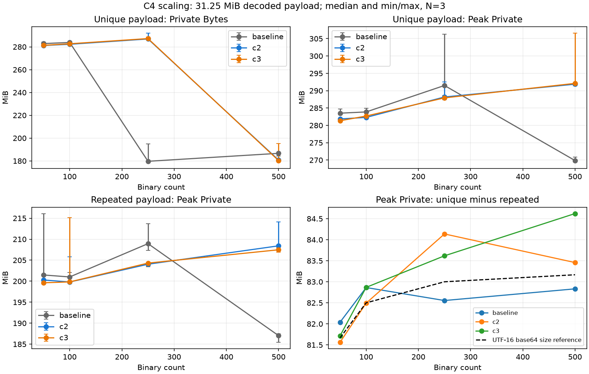

# BinaryStore C4: память и Open после C3

## Baseline

Статус: **COMPLETE как диагностический этап, без production fix и push**.
Причины поведения памяти подтверждены runtime и причинными экспериментами;
добавленная стоимость Open локализована в attach bridge. Историческое
end-to-end Open warning не воспроизвелось в двух адресных повторных сериях;
его точная причинная атрибуция остаётся ограничением, а не заявленным PASS.
Диагностический этап выполнен на текущем checkout.
База C3 — `2f0113b2566a3510c74e7e1c4536e9d10e4be0c8`, Baseline —
`a4145d832b9be02930400969328b2f5a0ec54182`, C2 —
`3e44dc5f621819c5a4d50009ad367e24c8ac4fea`.
На старте уже были изменены `performance-binary-store-c3.md` и внешний
`binary-store-driver.cpp`; стартовый diff и хеши сохранены в `out/perf/c4`.
Они не откатывались. Во время последующей сверки C3 в его документ добавлена
заметка о проверке готового evidence; исторические таблицы C3 не заменялись C4.

Защищённое evidence: `out/perf/results-2f0113b2-final64-uiwait`.
Пять JSON (manifest/raw/summary/acceptance-audit/regression-analysis) сверяются
с `out/perf/c4/baseline.json`. Исходные runtime snapshots не пересобирались
и не модифицировались. Диагностика собиралась в отдельный каталог.

## Observed regressions

Исходный C3 benchmark: 9 warm-up, 63 measured, equivalence PASS.
C3 против C2: large mutation быстрее на 17.12%, metadata на 1.74–4.25%;
Open median control хуже на 5.33%, many на 7.80%, large лучше на 2.06%.
Существенной экономии памяти нет: large Private после Open 254.89→254.32 MiB;
общий Peak Private 1375.34→1374.90 MiB.

Many против Baseline: C2/C3 Peak Private после Open +8.17%/+8.10%,
Peak WS +7.28%/+7.38%. Эти ухудшения >5% были во всех семи парах.
Временные Open warnings в исходном прогоне превышали 5% только в 2/7 пар;
их нельзя превращать в доказательство постоянного 5–8% overhead.
Независимый пересчёт пар одинакового round: median относительного замедления
C3 против C2 составляет control +2.16%, many **-0.05%**, large +0.18%.
Отношение двух отдельных medians (+5.33%/+7.80%) не равно median парных
изменений: меняются отсчёты, попадающие в середину каждого распределения.
На many C3 быстрее в четырёх из семи пар, несмотря на худший отдельный median.
Это объясняет, почему исходная таблица не доказывает постоянную стоимость
Open в 5–8%; исходные medians корректны и не удалены. Физическая причина
разброса каждого исторического запуска этим арифметическим анализом не доказана.
Полная исходная статистика остаётся в [отчёте C3](performance-binary-store-c3.md).

## Instrumentation

Все нативные новые поля, функции и обработчик включаются только через
`FBE_BINARY_STORE_DIAGNOSTICS`. При обычной компиляции macros не выполняют
операций; TEST-сценарий отсутствует. IDL, DISPIDs и публичный API не менялись.

- `BinaryDiagnostics.h`: QPC scopes, Put/Get/Attach, reconciliation,
  metadata invalidation, полные native DOM scans, размеры нативных bitmap.
- `BinaryPayloadDiagnostics.h`, методы PayloadStore/Store: уникальные
  CComVariant и адреса SAFEARRAY pvData, bytes/history/shared references,
  отдельный подсчёт payload текущего DOM-каталога, оценка metadata.
- `RuntimeTestBinaryStoreC4.inl`: чтения из C++ и настоящего JScript,
  detach behavior на том же DOM-элементе, edits/Undo/Redo, XML/Source Apply.
- FBDoc, BinaryDocumentStore, ScriptBinaryDocument, Utils: только scopes и
  counters. Изображения измеряются по abs(pitch)×height после decode.

Диагностический EXE: SHA-256
`EAD83943B8EB06FF75771EDD4EE3E22002087D06C3422D7CB17A16536DB48F1F`.
Изолированный diagnostic main.js:
`0F7292CF3478D769EF56122585934674999C0A03378C3A794E9C42FD340BBEF2`.
Он содержит приватные обёртки диагностических функций; snapshots main.js
не изменены. Counter totals накопительные, не число одновременно живых
временных массивов. `temporary_get_bytes_total` — суммарный трафик копирования.

`canonical_bytes` в исходном owner-статусе означает все значения owner map,
включая старые DOM nodes до их освобождения. Для текущего документа использовать
`current_document_bytes`; `noncurrent_owner_bytes` — разница union с текущим
каталогом. `history_only_bytes` — payload leases, отсутствующие в owner map,
а не все исторические DOM-состояния. Иначе Source Apply легко ошибочно
принять за постоянную копию текущего binary.

Private = PROCESS_MEMORY_COUNTERS_EX.PrivateUsage; Peak Private =
PeakPagefileUsage. Это private commit и его исторический максимум, не
зарезервированное адресное пространство и не сумма живых payload objects.
WS отражает резидентные страницы и включает разделяемые страницы.
Определения: [Microsoft PROCESS_MEMORY_COUNTERS_EX](https://learn.microsoft.com/en-us/windows/win32/api/psapi/ns-psapi-process_memory_counters_ex).
OS peak не уменьшается после GC. Все MiB здесь равны 2^20 bytes.

## Memory ownership findings

### Canonical owner и legacy facade

В C2 decoded SAFEARRAY уже существовал в единственном экземпляре как DOM
expando; C3 переносит именно этот экземпляр в native document owner. Это
не удаление одной из двух уже существовавших полных копий. Behavior содержит
weak state + key/identity, а не массив. Get вызывает VariantCopy, Put —
VariantCopyInd; массив caller изолирован от canonical. Нормальный Open
присоединяет behavior до первого put, поэтому legacy expando не создаётся.

После Open many: 500 canonical blocks, 32768000 B; large: 10 blocks,
31507926 B. History пустая, noncurrent bytes = 0. Подсчёт выполнен по
уникальным underlying addresses, не только по shared_ptr wrappers.
В DOM attribute inventory `base64data` отсутствует. Метка
`open_no_facade_access` означает отсутствие **дополнительных** probe reads:
сам Open читает два изображения many для построения интерфейса.

После пяти полных C++ чтений canonical counts/bytes неизменны. После
пяти полных JScript чтений many Private растёт 194252800→353746944 B,
но после CollectGarbage падает до 189030400 B; canonical остаётся
500 blocks / 32768000 B. Large: 290066432→448040960→170655744 B,
canonical 10 blocks / 31507926 B. Это временные Automation values,
ожидающие JScript GC, а не постоянная вторая canonical copy.

На **том же** прочитанном DOM-элементе удалён behavior, вызвана та же JS-функция
чтения: usable_payload_survived=0, getter_calls=0, canonical_expired=1.
Независимый native get после detach возвращает DISP_E_UNKNOWNNAME, VT_EMPTY,
при удерживаемом DOM. Поэтому проверка покрывает и JScript binding, и
attribute/property backing storage; вывод не основан только на source review.

### Per-entry overhead и Undo

Оценка metadata many — 106120 B (около 104 KiB), behavior sizeof=40 B,
CComVariant=16 B, shared_ptr=8 B. Оценка metadata не включает allocator
headers и все COM allocations. Даже дополнение map/control blocks нельзя
объявлять полным измерением process overhead. Canonical payload many —
31.25 MiB, существенно больше измеренного metadata estimate.

Для many 1 edit удерживает дополнительный старый payload 65536 B;
5 edits same binary — около 327684 B, union 505 blocks. Для large
5 edits same binary — 15756484 B history-only, union 15 blocks.
Это пять изменённых payload, а не пять полных копий книги. Undo all/Redo all
используют тот же union; разница в один byte соответствует тестовому tail.
Пять edits different binaries также удерживают пять старых значений.
PB может расти при Undo/Redo из-за временных COM/JScript copies, хотя
unique underlying block count не меняется. Все точки и WS даны ниже.

После настоящего Source edit + Apply large на короткое время содержит
63015852 B owner payload: текущая и старая версии DOM по 31507926 B.
После GC снова 31507926 B; discard Undo + GC не даёт ещё одной полной
экономии. Many аналогично возвращается к 32768000 B. Это не постоянная
двойная копия текущего payload и не накопление API Undo leases.

### XML, изображения, Source и Save

Открытие использует MSXML input DOM, typed base64 → SAFEARRAY, XSLT processor
и JScript wrappers. Locals становятся недоступными логически раньше, чем GC
освобождает их COM references. Source/CreateDOM дополнительно строят полный
XML и UTF-16 base64. Live full-XML BSTR many = 87479730 B, large = 84037458 B;
Scintilla Source UTF-8 = 43739882 B / 42018746 B. Canonical bytes в этих
точках не меняются.

На large CreateDOM повышает Private 183.11→293.83 MiB, удержание XML BSTR
до 374.19 MiB; release + GC возвращает примерно 183.42 MiB. Source view
занимает 534.05 MiB; после Apply + GC 828.88 MiB при canonical 30.05 MiB.
Остаток не приписывается BinaryPayloadStore: в нём нет соответствующего
роста blocks. MSHTML/Scintilla/COM heap полностью по типам не разложены.
Это накопительная диагностическая последовательность, не median из C3.

Native dimension decode many: два bitmap по 24 B. Large: десять bitmap по
3145728 B, суммарно 30 MiB, max single 3 MiB. CImage scoped и уничтожается
после определения dimensions; сумма decode bytes не означает одновременно
живые bitmap. MSHTML render buffers отдельно не подсчитаны. Image decode
не объясняет 500-entry many regression с двумя крошечными картинками.

В idle после Open временных save buffers нет. SaveToFile строит local
CreateDOMImp(compactBinaries=true), валидирует его SAX stream и вызывает
raw_save во временный файл; filesystem temporary file не является постоянным
RAM payload. COM DOM/stream locals освобождаются при выходе. Прямое
live-XML наблюдение выше подтверждает порядок величины staging, но размер
полного BSTR не объявляется точным overhead обычного Save: Save использует
compact XML и stream, без обязательного full-document BSTR. C4 Save peak
отдельно не профилировал; исходные реальные Save peaks сохранены в C3.

## Open profiling

Разделены три контура: неизменённые production snapshots с внешним контроллером,
instrumented native EXE и JS call-site profiling. Их времена нельзя складывать
или смешивать как единую performance acceptance.

Нативный профиль одного Open C3 (ms; вложенные scopes):

| Fixture | LoadFromHTML | Browser/DOM ready | apiLoadFB2 | Population | Attach | Reconcile | Metadata/index | Decode |
|---|---:|---:|---:|---:|---:|---:|---:|---:|
| control | 388.94 | 279.22 | 102.79 | 0.005 | 0.066 | 0.002 | 0.007 | 18.33 |
| many | 1433.99 | 460.92 | 963.40 | 2.735 | 3.830 | 0.082 | 0.905 | 8.04 |
| large | 940.00 | 276.26 | 656.35 | 8.090 | 0.139 | 0.005 | 0.036 | 184.72 |

Document fully ready измеряется внешним process-start QPC, а не окончанием
LoadFromHTML. Native `binary_discovery=0` означает отсутствие полного C++
Objects scan во время Open, а не отсутствие JS discovery. Отдельная JS
телеметрия показывает один полный binobj enumeration, N возвращённых entries,
для C2 и C3; PutBinaries читает XML inventory один раз. Reconcile: N+2 calls,
metadata construction N, Attach N, Put N, same-value puts=0,
metadata invalidations=0. Нет 500×full DOM scan у C2/C3. RebuildImagesInfo
при Open не вызывался, но это не отменяет image processing внутри apiAdd.

JS profile (3 measured после warm-up) даёт many attach_bridge 10 ms median
(500 вызовов), против native attach 3.83 ms в отдельном probe: bridge включает
переход JScript/COM и окружающий native call. C2 такого этапа не имеет.
Facade put bridge: C2/C3 по 6 ms; новый постоянный payload copy pass не найден.
Большие этапы many — XML transform/PutBinaries/HTML controls, а large также
image decode. Полная таблица ниже; JS Date-wrapper allocation меняет GC и
не служит измерением production RAM или точного overhead end-to-end Open.

Отдельный Open recheck на неизменённых snapshots: 1 warm-up + 7 measured
на каждый C2/C3×fixture, ротация сохранена. C3 vs C2 median: control
1556.22 vs 1568.04 ms (-0.75%), many 2757.07 vs 2792.48 (-1.27%),
large 2739.40 vs 2751.98 (-0.46%). Подтверждён небольшой дополнительный
attach path, но прежнее end-to-end замедление 5–8% не воспроизвелось.
Причина точного расположения median в историческом прогоне не установлена;
не следует объявлять её доказанной утечкой, O(N²), extra copy или доказанным
шумом. Исторические warnings остаются в C3, C4 не подменяет их новым PASS.

Контроллер C4 использует SendMessageCallback с message pump и подтверждением
завершения Body command: median 6–10 ms; readiness также требует inventory и
имени книги в title. Это отдельный диагностический протокол, не исправление
FBE. Начальные scaling attempts с дополнительной синхронной UI-командой на
0/1 binary дали timeout без measurements. Сохранены как interrupted;
использован разрешённый ближайший контроль 2 binaries / 8 KiB. Конкретная
причина этих UI timeouts не доказана. Callback dispatch требует message pump:
[Microsoft SENDASYNCPROC](https://learn.microsoft.com/en-us/windows/win32/api/winuser/nc-winuser-sendasyncproc).

Чтобы проверить влияние протокола, выполнена ещё одна серия с синхронным
SendMessageTimeout (legacy): 6 warm-up + 42 measured, по 7 повторов C2/C3
на fixture. C2→C3 Open median: control 1442.84→1451.88 ms (+0.63% времени),
many 2757.26→2676.48 ms (-2.93%), large 2773.23→2634.78 ms (-4.99%).
Предупреждение о 5–8% end-to-end overhead не воспроизводится и здесь.
Legacy diagnostic controller ограничивает ожидание команды 10 секундами,
поэтому его нельзя объявлять побайтово тем же harness, что C3. Оба контура
используют неизменённые production EXE/JS, без фазовых JS timers и GC overlay.

## Root cause(s)

Scaling проведён с фиксированными **32768000 decoded bytes** при 50,100,250,500
entries, плюс 2-entry near-zero и 500-entry 4 MiB point. Три реализации,
по одному warm-up и три measured: 18+54 runs в каждом из двух экспериментов.
Первый использует одинаковое содержимое payload; второй меняет индекс в
последних четырёх bytes PNG padding, сохраняя lengths, MIME и references.



Unique−repeated Peak Private различается примерно на 82–85 MiB, хотя
decoded total и count одинаковы. Это соответствует порядку величины
UTF-16 base64 (83.33 MiB на весь payload); BinaryStore не выполняет dedup
между IDs. Поэтому нельзя интерпретировать низкую память repeated-content
fixture как экономию decoded canonical store. Доказан вклад представлений
вне native owner, зависящих от содержимого; точная внутренняя стратегия
MSXML string sharing без heap attribution не установлена.

Зависимость памяти не описывается только count×sizeof(metadata).
Для unique-content Peak Private C2/C3−Baseline при N=50/100/250 отрицательна,
при N=500 около +22 MiB; у Baseline есть скачок downward при N=500.
При N=500 уменьшение total с 31.25 до 4 MiB снижает peaks примерно с
270–292 до 95–101 MiB. OLS fixed+per-entry ниже оставлен как описательный fit:
его intercept включает payload/XML, а slope не равен размеру C++ entry.
Нелинейная граница lifetime/GC важнее размера metadata.

Причинная проверка original many: private JS overlay вызывает GC каждые
50 загруженных binary, до завершения Open. Это только изолированные копии,
не production patch. 9 warm-up + 27 measured, 36 сохранений прошли независимые
XSD, decoded SHA, MIME, references. C2 peak 291.82→259.71 MiB,
C3 291.86→260.26 MiB; превышение над Baseline исчезает. Следовательно,
неизбежный размер native metadata/behavior не создаёт эти дополнительные
~32 MiB. Время освобождения временных JScript/COM input values причинно
влияет на peak; source подтверждает SAFEARRAY materializations при загрузке.
В Baseline старый O(N²) поиск ID создаёт иной allocation profile; C2/C3 его
заменили native index. Связь этого изменения с конкретной автоматической
GC boundary — интерпретация source + intervention, не трассировка GC epoch.

Отдельное вмешательство OANOCACHE=1 почти не изменило peaks C2/C3:
291.82→291.56 / 291.86→291.51 MiB. BSTR cache не является основной причиной
many peak gap. Переменная задана только новым child processes и восстановлена;
глобальные registry настройки не менялись. Основание эксперимента:
[Microsoft Preparing to Use UMDH](https://learn.microsoft.com/en-us/windows-hardware/drivers/debugger/preparing-to-use-umdh).

Классификация:

| Категория | Вывод |
|---|---|
| A, permanent duplicate | Не обнаружена: адреса, actual JScript reads, detach и GC не подтверждают вторую постоянную decoded copy. |
| B, MSHTML/MSXML/base64 вне owner | Подтверждён крупный вклад XML/Source и content-dependent представлений; полный heap breakdown отсутствует. |
| C, per-entry dominates | Не подтверждено: metadata около 104 KiB, gap нелинеен и устраняется GC intervention. |
| D, Undo | Удерживает изменённые версии, large пять edits около 15 MiB; не объясняет no-edit Open gap. |
| E, reserved pages | Не доказано. Нельзя делать вывод о reserve из Private Bytes. |
| F, image buffers | Native decode измерен; не причина many regression. Все MSHTML image caches не атрибутированы. |
| G, metric semantics | Private/Peak измеряют committed memory; peak исторический. Это корректный счётчик, не ошибка замера live payload. |
| H, GC/lifetime временных Automation values | Причинно подтверждено JScript reads + GC и periodic GC experiment; точный heap-type breakdown остаётся ограничением. |

## Changes made

Production fix **не принят**. Periodic GC уменьшает peak, но одновременно
ухудшает Private сразу после Open: C2 180.58→258.32 MiB,
C3 180.21→258.23 MiB. Только следующий post-Open GC снижает до ~174 MiB.
Без этого отрицательного результата такой patch выглядел бы успешным.
Принудительный GC в production Open без отдельной проработки lifecycle
не удовлетворяет критерию отсутствия другой существенной регрессии.

Добавлены диагностические headers/scenario, условные scopes в source,
внешние C4 controllers и PowerShell runners, JS profiling overlays,
`analyze-binary-store-c4.py`, этот документ и график. Исходные scripts пользователей
не меняются. IDL/API/FB2/Undo architecture не менялись. Никаких dedup,
compression, mmap, temp payload storage, workers или C++20.

Нативная diagnostic Release /W4 /WX compilation прошла; это компиляция
только FBE в отдельном OutDir/IntDir с macro, не повтор закрытого release gate.
MSBuild сообщил MSB8028 из-за общего заданного diagnostic IntDir для связанных
проектов; это не C++ warning. Общую build infrastructure в C4 не меняли.
Ранние diagnostic FAIL (неверный IHTMLElement interface, неподходящий MIME
тестового replacement) исправлены в probe, не в production behavior;
первичные логи сохранены.

## Before/After

Production before/after отсутствует: binary SHA snapshots тот же.
Open recheck и causal interventions приведены отдельно и не заявлены
улучшением C4. Mutation/metadata не перезапускались: закрытые результаты C3
остаются исходной точкой. Legacy 46/46, bundled 6/6, ownership, XML Undo,
ASan targeted 5/5, ASan unit, ASan FAST 84/84, UBSan 5/5 — inherited C3 PASS,
в C4 **не повторялись**. Новый диагностический probe control/many/large PASS,
включая объём Undo и реальный Source Apply. Functional equivalence causal
Save outputs — собственное C4 evidence, не замена полного legacy suite.

## Remaining limits

Точный причинный разбор **исторических** +5/+8% Open medians не доказан:
повтор не воспроизводит устойчивый эффект, а измеренный новый attach path
слишком мал, чтобы приписать ему всю прежнюю разницу. Следующий этап при
повторяемом пользовательском slowdown — trace на том же сценарии с GC/COM
allocation epochs; не speculative refactor attach/metadata.

Native/JS phases — diagnostic samples; timers вложенные. Scaling N=3 годится
для диагноза, не для release claims. Каждый Open experiment ограничен
готовностью документа, не доказывает полный GUI lifecycle/Close.
Полный разбор MSHTML/MSXML/Scintilla heap по типам и render caches не выполнен.
Попытка CDB `!heap` сохранена в `heaps-c2`: debug heap был включён,
segment heap extension завершилась ошибкой чтения; эти данные исключены из
количественных выводов. На их основании нельзя заявить E/reserve diagnosis.

External OLE / FullValidation вне C4, manual GUI smoke pending.
Push/commit не выполнялись; текущие изменения доступны для review.

### Воспроизведение и evidence

Все команды запускать из checkout; runners вычисляют root от PSScriptRoot.
Пути outputs должны быть **новыми**: существующие manifest не перезаписываются.
Не запускать builds, sanitizers и другие FBE workloads одновременно с timed runs.

```powershell
./tools/perf/build-binary-store-c4-diagnostic.ps1
./tools/perf/run-binary-store-c4-probe.ps1 -OutputDirectory ./out/perf/c4/new-probes
./tools/perf/run-binary-store-c4-experiment.ps1 -Experiment open-recheck -OutputDirectory ./out/perf/c4/new-open
./tools/perf/run-binary-store-c4-experiment.ps1 -Experiment profile-js -OutputDirectory ./out/perf/c4/new-profile
./tools/perf/run-binary-store-c4-experiment.ps1 -Experiment memory-cause -OutputDirectory ./out/perf/c4/new-cause
./tools/perf/run-binary-store-c4-scaling.ps1 -OutputDirectory ./out/perf/c4/new-scaling
```

Текущий scaling runner создаёт unique-content вариант; repeated-content
входы и frozen driver сохранены в `scaling-open-only`, unique — в
`scaling-unique`, оба со своими fixture hashes. Для сравнения content effects
использовать именно эти сохранённые inputs, не менять total decoded bytes.

Основные evidence каталоги под `out/perf/c4`:
`probes-js-binding`, `probes-exact-blocks`, `scaling-open-only`, `scaling-unique`,
`memory-cause`, `open-recheck`, `profile-js`; manifest, raw, per-run TSV,
JSON profiles, reports, hashes. Они generated и не добавляются в Git.
Анализ raw воспроизводится явным Python с matplotlib для графика:

```powershell
& '<python-with-matplotlib>' tools/perf/analyze-binary-store-c4.py --audit --plot docs/performance-assets/binary-store-c4-scaling.png
```

`analysis.json` содержит recomputed N/median/p90/min/max, OLS fits, JS phases,
все ownership stages. Таблицы ниже получены тем же helper (`tables.md`).
`open-recheck-legacy` содержит вторую адресную Open-серию.
`completion-audit.json` подтверждает hashes пяти защищённых C3 JSON,
2551 файлов snapshots, исходных/scaling fixtures, counts всех шести
экспериментов, 36 causal saved equivalence records и ownership assertions
после actual JScript reads и Source Apply GC. Этот аудит проверяет перечисленные
contours и не подменяет не выполненный полный COM heap breakdown.

## Численные приложения

### Open recheck: неизменённые C2/C3, N=7

| Fixture | Вариант | median ms | p90 ms | min ms | max ms |
|---|---|---|---|---|---|
| control | c3 | 1556.22 | 1779.07 | 1466.05 | 1779.07 |
| control | c2 | 1568.04 | 1616.82 | 1523.65 | 1616.82 |
| many | c3 | 2757.07 | 2873.36 | 2723.85 | 2873.36 |
| many | c2 | 2792.48 | 2864.93 | 2750.78 | 2864.93 |
| large | c3 | 2739.40 | 2795.84 | 2683.43 | 2795.84 |
| large | c2 | 2751.98 | 2901.40 | 2598.86 | 2901.40 |

### Open recheck: синхронный legacy протокол, N=7

| Fixture | Вариант | median ms | p90 ms | min ms | max ms |
|---|---|---|---|---|---|
| control | c3 | 1451.88 | 1682.77 | 1425.18 | 1682.77 |
| control | c2 | 1442.84 | 1528.94 | 1401.36 | 1528.94 |
| many | c3 | 2676.48 | 2819.67 | 2564.96 | 2819.67 |
| many | c2 | 2757.26 | 2952.73 | 2586.78 | 2952.73 |
| large | c3 | 2634.78 | 3143.66 | 2549.84 | 3143.66 |
| large | c2 | 2773.23 | 2950.34 | 2671.68 | 2950.34 |

### Scaling: уникальные payload, N=3; медианы MiB

| N binaries / decoded MiB | Вариант | Private | WS | Peak Private | Peak WS |
|---|---|---|---|---|---|
| n002-8k / 0.008 | baseline | 47.41 | 85.87 | 48.16 | 85.97 |
| n002-8k / 0.008 | c2 | 47.33 | 85.89 | 48.34 | 85.89 |
| n002-8k / 0.008 | c3 | 47.37 | 85.87 | 47.80 | 85.87 |
| n050-32m / 31.250 | baseline | 282.88 | 321.12 | 283.52 | 321.14 |
| n050-32m / 31.250 | c2 | 281.21 | 319.78 | 281.85 | 319.80 |
| n050-32m / 31.250 | c3 | 281.33 | 319.92 | 281.33 | 319.92 |
| n100-32m / 31.250 | baseline | 283.85 | 322.53 | 283.87 | 322.53 |
| n100-32m / 31.250 | c2 | 282.25 | 320.83 | 282.30 | 320.83 |
| n100-32m / 31.250 | c3 | 282.69 | 321.15 | 282.70 | 321.15 |
| n250-32m / 31.250 | baseline | 179.68 | 217.61 | 291.49 | 322.46 |
| n250-32m / 31.250 | c2 | 286.93 | 325.59 | 288.18 | 325.61 |
| n250-32m / 31.250 | c3 | 287.25 | 325.96 | 287.93 | 325.96 |
| n500-32m / 31.250 | baseline | 186.65 | 225.25 | 269.87 | 301.29 |
| n500-32m / 31.250 | c2 | 180.75 | 219.61 | 291.88 | 323.62 |
| n500-32m / 31.250 | c3 | 180.34 | 219.25 | 292.10 | 323.53 |
| n500-4m / 4.000 | baseline | 99.33 | 136.93 | 100.66 | 138.34 |
| n500-4m / 4.000 | c2 | 98.43 | 131.51 | 100.82 | 133.50 |
| n500-4m / 4.000 | c3 | 93.83 | 132.73 | 94.69 | 133.02 |

### OLS fixed + count: только 31.25 MiB, N=50/100/250/500

Описательные process-level fits, не размер нативного объекта.

| Content | Variant | Metric | Intercept MiB | B/entry | R² |
|---|---|---|---|---|---|
| scaling-open-only | baseline | after_open_private_bytes | 204.56 | -251393.3 | 0.694 |
| scaling-open-only | baseline | after_open_working_set | 243.05 | -251798.7 | 0.690 |
| scaling-open-only | baseline | after_open_peak_private_commit | 206.46 | -31896.1 | 0.452 |
| scaling-open-only | baseline | after_open_peak_working_set | 245.03 | -50705.1 | 0.824 |
| scaling-open-only | c2 | after_open_private_bytes | 226.49 | -239180.3 | 0.797 |
| scaling-open-only | c2 | after_open_working_set | 265.25 | -239679.2 | 0.796 |
| scaling-open-only | c2 | after_open_peak_private_commit | 198.75 | 20455.8 | 0.973 |
| scaling-open-only | c2 | after_open_peak_working_set | 238.73 | 5117.5 | 0.292 |
| scaling-open-only | c3 | after_open_private_bytes | 226.81 | -242010.1 | 0.797 |
| scaling-open-only | c3 | after_open_working_set | 265.32 | -240678.7 | 0.799 |
| scaling-open-only | c3 | after_open_peak_private_commit | 198.67 | 19288.0 | 0.961 |
| scaling-open-only | c3 | after_open_peak_working_set | 238.71 | 5342.4 | 0.344 |
| scaling-unique | baseline | after_open_private_bytes | 286.83 | -249641.2 | 0.690 |
| scaling-unique | baseline | after_open_working_set | 325.12 | -249316.0 | 0.685 |
| scaling-unique | baseline | after_open_peak_private_commit | 288.80 | -30801.1 | 0.435 |
| scaling-unique | baseline | after_open_peak_working_set | 327.14 | -47934.1 | 0.789 |
| scaling-unique | c2 | after_open_private_bytes | 308.50 | -236373.5 | 0.785 |
| scaling-unique | c2 | after_open_working_set | 347.02 | -235686.3 | 0.784 |
| scaling-unique | c2 | after_open_peak_private_commit | 280.80 | 24471.5 | 0.951 |
| scaling-unique | c2 | after_open_peak_working_set | 320.51 | 9131.6 | 0.442 |
| scaling-unique | c3 | after_open_private_bytes | 308.95 | -237902.4 | 0.784 |
| scaling-unique | c3 | after_open_working_set | 347.42 | -237002.8 | 0.783 |
| scaling-unique | c3 | after_open_peak_private_commit | 280.58 | 25303.2 | 0.969 |
| scaling-unique | c3 | after_open_peak_working_set | 320.82 | 8468.7 | 0.373 |

### Причинные вмешательства: original many, N=3; медианы MiB / ms

| Variant | Mode | Private Open | Peak Private Open | Private after GC | Open ms |
|---|---|---|---|---|---|
| baseline | default | 199.64 | 271.33 | 178.74 | 5044.48 |
| baseline | periodic-gc | 261.15 | 262.27 | 174.37 | 4896.35 |
| baseline | no-bstr-cache | 184.42 | 269.36 | 174.18 | 4988.67 |
| c2 | default | 180.58 | 291.82 | 177.58 | 2843.56 |
| c2 | periodic-gc | 258.32 | 259.71 | 174.16 | 2800.26 |
| c2 | no-bstr-cache | 180.31 | 291.56 | 177.20 | 2701.24 |
| c3 | default | 180.21 | 291.86 | 177.16 | 2695.67 |
| c3 | periodic-gc | 258.23 | 260.26 | 174.13 | 2694.00 |
| c3 | no-bstr-cache | 180.35 | 291.51 | 177.21 | 2677.97 |

### Ownership/Undo/Source: many, один диагностический процесс

Bytes exact; PB/WS — MiB. Счётчики объектов не включают COM/MSHTML heap.

| Stage | Current bytes | History-only bytes | All unique blocks | Noncurrent bytes | PB | WS |
|---|---|---|---|---|---|---|
| open_no_facade_access | 32768000 | 0 | 500 | 0 | 185.02 | 212.33 |
| after_dom_catalog_enumeration | 32768000 | 0 | 500 | 0 | 185.20 | 212.51 |
| after_one_facade_read_released | 32768000 | 0 | 500 | 0 | 185.20 | 212.52 |
| after_five_full_facade_reads_released | 32768000 | 0 | 500 | 0 | 185.20 | 212.52 |
| after_js_one_read_returned | 32768000 | 0 | 500 | 0 | 185.25 | 212.57 |
| after_js_five_full_reads_returned | 32768000 | 0 | 500 | 0 | 337.36 | 364.09 |
| after_js_reads_gc | 32768000 | 0 | 500 | 0 | 180.27 | 207.69 |
| after_dom_attribute_inventory | 32768000 | 0 | 500 | 0 | 202.63 | 227.39 |
| after_js_gc | 32768000 | 0 | 500 | 0 | 198.83 | 223.69 |
| one_binary_edit | 32768001 | 65536 | 501 | 65536 | 200.47 | 225.29 |
| five_edits_same_binary | 32768001 | 327684 | 505 | 327684 | 205.17 | 229.97 |
| undo_all_same_binary | 32768000 | 327685 | 505 | 327685 | 208.35 | 233.22 |
| redo_all_same_binary | 32768001 | 327684 | 505 | 327684 | 209.28 | 234.36 |
| reopened_before_different_edits | 32768000 | 0 | 500 | 0 | 206.71 | 231.48 |
| five_edits_different_binaries | 32768005 | 327680 | 505 | 327680 | 224.36 | 248.75 |
| undo_all_different_binaries | 32768000 | 327685 | 505 | 327685 | 226.96 | 251.58 |
| redo_all_different_binaries | 32768005 | 327680 | 505 | 327680 | 227.26 | 251.89 |
| before_serialization | 32768000 | 0 | 500 | 0 | 223.26 | 244.65 |
| serialization_dom_live | 32768000 | 0 | 500 | 0 | 336.83 | 361.77 |
| serialization_bstr_live | 32768000 | 0 | 500 | 0 | 415.64 | 441.12 |
| after_serialization_released | 32768000 | 0 | 500 | 0 | 218.26 | 244.21 |
| source_view_live | 32768000 | 0 | 500 | 0 | 582.01 | 566.70 |
| body_after_source_apply | 32768000 | 0 | 500 | 0 | 928.64 | 907.71 |
| body_after_source_apply_gc | 32768000 | 0 | 500 | 0 | 904.40 | 885.29 |
| after_source_undo_discard_gc | 32768000 | 0 | 500 | 0 | 902.75 | 883.64 |

### Ownership/Undo/Source: large, один диагностический процесс

Bytes exact; PB/WS — MiB. Счётчики объектов не включают COM/MSHTML heap.

| Stage | Current bytes | History-only bytes | All unique blocks | Noncurrent bytes | PB | WS |
|---|---|---|---|---|---|---|
| open_no_facade_access | 31507926 | 0 | 10 | 0 | 273.59 | 314.59 |
| after_dom_catalog_enumeration | 31507926 | 0 | 10 | 0 | 273.61 | 314.64 |
| after_one_facade_read_released | 31507926 | 0 | 10 | 0 | 273.61 | 314.64 |
| after_five_full_facade_reads_released | 31507926 | 0 | 10 | 0 | 273.61 | 314.64 |
| after_js_one_read_returned | 31507926 | 0 | 10 | 0 | 276.63 | 317.66 |
| after_js_five_full_reads_returned | 31507926 | 0 | 10 | 0 | 427.29 | 468.04 |
| after_js_reads_gc | 31507926 | 0 | 10 | 0 | 162.75 | 204.25 |
| after_dom_attribute_inventory | 31507926 | 0 | 10 | 0 | 166.39 | 207.50 |
| after_js_gc | 31507926 | 0 | 10 | 0 | 165.64 | 206.84 |
| one_binary_edit | 31507927 | 3151296 | 11 | 3151296 | 171.75 | 213.06 |
| five_edits_same_binary | 31507927 | 15756484 | 15 | 15756484 | 195.57 | 236.95 |
| undo_all_same_binary | 31507926 | 15756485 | 15 | 15756485 | 211.40 | 252.75 |
| redo_all_same_binary | 31507927 | 15756484 | 15 | 15756484 | 226.54 | 267.92 |
| reopened_before_different_edits | 31507926 | 0 | 10 | 0 | 174.77 | 224.20 |
| five_edits_different_binaries | 31509714 | 15754697 | 15 | 15754697 | 207.91 | 257.32 |
| undo_all_different_binaries | 31507926 | 15756485 | 15 | 15756485 | 223.87 | 273.16 |
| redo_all_different_binaries | 31509714 | 15754697 | 15 | 15754697 | 205.62 | 254.95 |
| before_serialization | 31507926 | 0 | 10 | 0 | 183.11 | 240.08 |
| serialization_dom_live | 31507926 | 0 | 10 | 0 | 293.83 | 350.61 |
| serialization_bstr_live | 31507926 | 0 | 10 | 0 | 374.19 | 430.99 |
| after_serialization_released | 31507926 | 0 | 10 | 0 | 183.42 | 240.59 |
| source_view_live | 31507926 | 0 | 10 | 0 | 534.05 | 550.59 |
| body_after_source_apply | 31507926 | 0 | 20 | 31507926 | 919.39 | 935.40 |
| body_after_source_apply_gc | 31507926 | 0 | 10 | 0 | 828.88 | 845.12 |
| after_source_undo_discard_gc | 31507926 | 0 | 10 | 0 | 828.67 | 844.90 |

### JScript Open phases, N=3, median ms; времена вложенные

| Fixture | Phase | C2 ms | C3 ms | C2 calls | C3 calls |
|---|---|---|---|---|---|
| control | apiLoadFB2 | 66.00 | 63.00 | [1, 1, 1] | [1, 1, 1] |
| control | LoadFromDOM | 52.00 | 50.00 | [1, 1, 1] | [1, 1, 1] |
| control | TransformXML | 42.00 | 40.00 | [1, 1, 1] | [1, 1, 1] |
| control | PutBinaries | 19.00 | 19.00 | [1, 1, 1] | [1, 1, 1] |
| control | apiAddBinary | 18.00 | 18.00 | [4, 4, 4] | [4, 4, 4] |
| control | BuildBinaryControls | 16.00 | 18.00 | [4, 4, 4] | [4, 4, 4] |
| control | RebuildImagesInfo | 0.00 | 0.00 | [0, 0, 0] | [0, 0, 0] |
| control | FillLists | 2.00 | 1.00 | [1, 1, 1] | [1, 1, 1] |
| control | attach_bridge | — | 0.00 | — | [4, 4, 4] |
| control | facade_put_bridge | 0.00 | 0.00 | [4, 4, 4] | [4, 4, 4] |
| control | dom_binary_enumeration | 0.00 | 0.00 | [1, 1, 1] | [1, 1, 1] |
| many | apiLoadFB2 | 839.00 | 961.00 | [1, 1, 1] | [1, 1, 1] |
| many | LoadFromDOM | 549.00 | 568.00 | [1, 1, 1] | [1, 1, 1] |
| many | TransformXML | 540.00 | 558.00 | [1, 1, 1] | [1, 1, 1] |
| many | PutBinaries | 507.00 | 525.00 | [1, 1, 1] | [1, 1, 1] |
| many | apiAddBinary | 261.00 | 255.00 | [500, 500, 500] | [500, 500, 500] |
| many | BuildBinaryControls | 175.00 | 168.00 | [500, 500, 500] | [500, 500, 500] |
| many | RebuildImagesInfo | 0.00 | 0.00 | [0, 0, 0] | [0, 0, 0] |
| many | FillLists | 55.00 | 55.00 | [1, 1, 1] | [1, 1, 1] |
| many | attach_bridge | — | 10.00 | — | [500, 500, 500] |
| many | facade_put_bridge | 6.00 | 6.00 | [500, 500, 500] | [500, 500, 500] |
| many | dom_binary_enumeration | 1.00 | 1.00 | [1, 1, 1] | [1, 1, 1] |
| large | apiLoadFB2 | 1188.00 | 1182.00 | [1, 1, 1] | [1, 1, 1] |
| large | LoadFromDOM | 461.00 | 460.00 | [1, 1, 1] | [1, 1, 1] |
| large | TransformXML | 452.00 | 451.00 | [1, 1, 1] | [1, 1, 1] |
| large | PutBinaries | 426.00 | 424.00 | [1, 1, 1] | [1, 1, 1] |
| large | apiAddBinary | 236.00 | 238.00 | [10, 10, 10] | [10, 10, 10] |
| large | BuildBinaryControls | 216.00 | 216.00 | [10, 10, 10] | [10, 10, 10] |
| large | RebuildImagesInfo | 0.00 | 0.00 | [0, 0, 0] | [0, 0, 0] |
| large | FillLists | 3.00 | 3.00 | [1, 1, 1] | [1, 1, 1] |
| large | attach_bridge | — | 1.00 | — | [10, 10, 10] |
| large | facade_put_bridge | 17.00 | 16.00 | [10, 10, 10] | [10, 10, 10] |
| large | dom_binary_enumeration | 0.00 | 0.00 | [1, 1, 1] | [1, 1, 1] |
